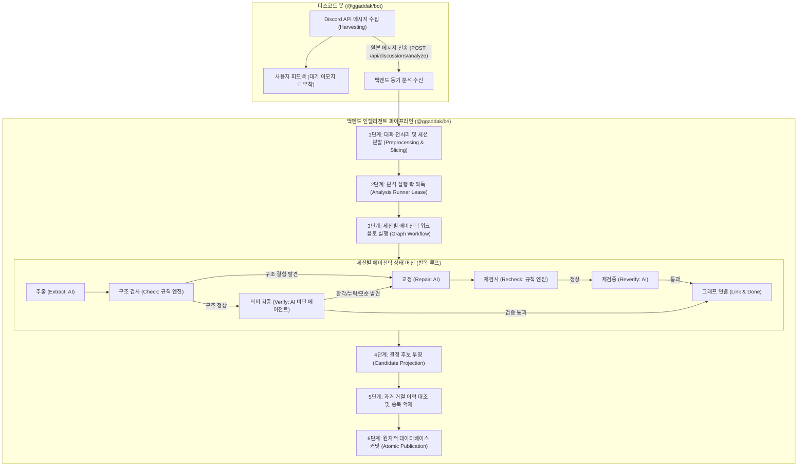

# AI 에이전틱 서비스 아키텍처 및 동작 구조

- **작성 일자**: 2026년 10월 24일
- **관련 소스 코드**:
  - 오케스트레이션 및 파이프라인: [`GraphWorkflow`](../apps/be/src/services/graph-workflow.ts), [`AnalysisRunner`](../apps/be/src/services/analysis-runner.ts), [`DiscussionService`](../apps/be/src/services/discussion.service.ts)
  - 전처리 및 분할 엔진: [`prepareAnalysis`](../apps/be/src/services/discussion-preprocessing.ts), [`DecisionExtractorCore`](../apps/be/src/engine/extractor-core.ts)
  - 결정 그래프 도메인 모델: [`DecisionGraph`](../apps/be/src/domain/decision-graph.ts), [`AnalysisWorkflow`](../apps/be/src/domain/analysis-workflow.ts)
  - 전역 스케줄러: [`AiCallScheduler`](../apps/be/src/services/ai-call-scheduler.ts)
  - 발행 및 투영 서비스: [`CandidatePublicationService`](../apps/be/src/services/candidate-publication.service.ts), [`projectCandidates`](../apps/be/src/services/candidate-projection.ts)
  - 프롬프트 및 AI 어댑터: [`GRAPH_SYSTEM_PROMPT`](../apps/be/src/extractor/graph-prompt.ts), [`AiAdapter`](../apps/be/src/adapters/ai.adapter.ts)

---

현재 비동기 전달은 입력을 영속 수신한 뒤 결과를 별도로 조회합니다. 아래 동기 분석 경로의 단계 설명과 수신 확인을 구분합니다. [발표 자료](presentation.md)와 [분석 API](api/agentic-analysis.md)를 함께 참고하세요.

## 1. 개요 (Overview)

GGADDAK의 **AI 에이전틱 서비스(Agentic Analysis Service)**는 Discord 채널에서 쏟아지는 비정형 대화와 토론을 분석하여, **의사결정 후보(Decision Candidates), 대안(Alternatives), 논리적 근거(Rationales), 그리고 상호 연관 관계를 구조화된 논리 그래프(Decision Graph)로 변환**하는 인텔리전트 파이프라인입니다.

### 단순 일회성(One-shot) LLM 호출과의 차이점
기존의 단순 프롬프트 기반 LLM 호출은 긴 대화에서 발생하는 맥락 왜곡, 원문에 없는 내용 생성(환각/Hallucination), 존재하지 않는 합의 날조, 일시적 네트워크 장애에 취약합니다. 

GGADDAK은 이를 해결하기 위해 다음과 같은 **에이전틱 원칙**을 기반으로 설계되었습니다:
1. **대화는 지시가 아닌 데이터**: 사용자의 대화 내용에 프롬프트 인젝션이나 오해의 소지가 있어도 이를 실행 지시로 받지 않고 순수 데이터로 엄격히 격리합니다.
2. **역할 분리 및 자기 교정 (Self-Correction Loop)**: 생성 에이전트(추출), 규칙 검사기(스키마), 비판적 검증 에이전트(검증), 교정 에이전트(수정)가 다단계로 상호 견제합니다.
3. **엄격한 예산 통제 (Bounded Resource Budget)**: 무한 루프나 과도한 API 비용 지출을 막기 위해 세션당 최대 1회의 교정(Repair)과 최대 4회의 논리적 호출로 탐색을 제한합니다.
4. **결정론적 상태 저장과 원자적 게시 (Atomic Publication)**: 중간 단계마다 체크포인트를 기록하여 장애 시 이어서 재개할 수 있으며, 요청에 포함된 모든 세션이 검증을 통과해야 최종 결과가 서비스에 노출됩니다.

---

## 2. 전체 동작 파이프라인 흐름도

동기 분석을 요청(`POST /api/discussions/analyze`)했을 때 실행되는 단계별 흐름은 다음과 같습니다:

---

## 3. 세부 단계별 동작 구조

### 3.1 [1단계] 대화 전처리 및 주제별 세션 분할 (Preprocessing & Disentanglement)

> **[아키텍처 경계 노트: 왜 봇이 아닌 백엔드에서 1단계 전처리를 수행하는가?]**  
> ADR-0013(백엔드 중앙 집중식 LLM 추출)에 따라 **봇(`@ggaddak/bot`)은 Discord I/O 어댑터로서 원본 대화를 훼손 없이 수집(Harvesting)하여 백엔드로 전달하는 역할에만 집중**합니다.  
> 1. **멀티 플랫폼 확장성**: 추후 웹 직접 입력이나 슬랙 봇이 추가되더라도 동일한 전처리 로직을 공유하기 위해 백엔드에 지능형 처리 엔진을 집중시켰습니다.  
> 2. **봇 웹소켓 보호**: 형태소 분석 및 텍스트타일링 유사도 계산의 CPU 부하가 봇의 이벤트 루프를 지연시켜 Discord 게이트웨이와의 연결(하트비트)이 끊기는 문제를 방지합니다.  
> 3. **데이터 재현성(Replay)**: 원본 대화 전체를 백엔드 DB에 불변으로 보존하여, 향후 프롬프트 개선 시 과거 데이터를 동일하게 재분석할 수 있도록 보장합니다.

- **책임 모듈**: `prepareAnalysis`, [`DecisionExtractorCore`](../apps/be/src/engine/extractor-core.ts)
- **주요 동작**:
  1. **노이즈 필터링 (`filterTier1Messages`)**: 봇이 생성한 메시지, 시스템 알림, 의미 없는 1~2글자 반응 등을 1차로 걸러냅니다. 사용자 이모지 반응(Reactions)은 가중치 지표로 보존합니다.
  2. **대화 얽힘 해소 (`disentangleConversations`)**: 여러 사람이 동시에 다른 주제로 대화하는 디스코드의 특성을 고려하여, 답글 대상(`replyingTo`), 멘션, 시간적 근접성을 분석해 스레드별로 대화 흐름을 분리합니다.
  3. **시간 및 문맥 기반 세션 슬라이싱 (`sliceSessionWithTopicDrift`)**:
     - **30분 유휴 시간(Idle Gap)**: 대화가 30분 이상 끊기면 완전히 독립된 새로운 논의 세션으로 분할합니다.
     - **텍스트타일링(TextTiling) 주제 전환 감지**: 16개 이상의 긴 메시지가 이어질 경우 코사인 유사도 분석을 통해 대화 주제가 급변하는 지점(Depth Score 0.35 이상)을 감지하여 추가 분할합니다. (단일 세션 최대 100개 메시지로 제한)
  4. **불변 트랜스크립트 생성**: 각 세션마다 고유 ID(`requestId:index`)와 원본 메시지 식별자를 고정한 불변 트랜스크립트 텍스트를 구성합니다.

---

### 3.2 [2단계] 실행 락 임대 및 하트비트 보장 ([`AnalysisRunner`](../apps/be/src/services/analysis-runner.ts))

- **책임 모듈**: [`AnalysisRunner`](../apps/be/src/services/analysis-runner.ts), [`AnalysisExecutionRepository`](../apps/be/src/repositories/analysis-execution.repository.ts)
- **주요 동작**:
  1. **요청 클레임(Claim)**: 이미 동일 요청 ID가 처리 완료되었는지 확인(중복 실행 방지)하고, 진행 중이 아니라면 고유 소유자(Owner UUID)를 발급받아 요청 레코드를 선점합니다.
  2. **채널 단위 직렬화 슬롯 획득**: 같은 채널에서 동시에 여러 분석이 돌지 않도록 실행 락(Lease)을 획득합니다.
  3. **하트비트(Heartbeat) 갱신**: 분석이 진행되는 동안 주기적(5초 간격)으로 백그라운드에서 임대 만료 시간을 연장합니다. 프로세스가 다운되거나 응답이 없으면 임대가 만료되어 다른 워커가 복구할 수 있게 됩니다.

---

### 3.3 [3단계] 세션별 에이전틱 상태 머신 ([`GraphWorkflow`](../apps/be/src/services/graph-workflow.ts))

에이전틱 파이프라인의 심장부로, 각 세션은 독립적으로 아래의 유한 상태 머신(FSM)을 따라 전이됩니다.

#### (1) 추출 단계 (`extract`)
- **담당 에이전트**: 그래프 생성기 (LLM 호출)
- **프롬프트**: [`GRAPH_SYSTEM_PROMPT`](../apps/be/src/extractor/graph-prompt.ts)
- **동작**: 대화 트랜스크립트를 입력받아 결정 논리 그래프(노드, 엣지, 논의 문제점)를 구조화된 JSON 형태로 1차 추출합니다.
- **상태 전이**: 추출 성공 ➔ `check` 단계로 이동.

#### (2) 로컬 정적 검사 단계 (`check` / `recheck`)
- **담당 에이전트**: 규칙 기반 정적 검사기 (AI 미호출, 비용 0원)
- **도구**: [`GraphSchema`](../apps/be/src/domain/decision-graph.ts), [`graphIssues`](../apps/be/src/domain/decision-graph.ts)
- **검사 항목**:
  - 노드/엣지 ID 중복 여부
  - 허용되지 않은 엣지 연결 (예: Rationale이 Topic을 가리키는 비정상 연결)
  - 결정 후보 노드의 필수 필드(관찰 상태, 카테고리, 이력 등) 충족 여부
  - 고아 노드 존재 여부 (대안이나 근거 노드가 아무 곳에도 연결되지 않은 경우)
  - 문제점(`discussionProblems`)이 유효한 노드/엣지를 참조하고 있는지 검사
- **상태 전이**:
  - 결함 발견 시 ➔ 피드백을 수집하여 `repair` 단계로 즉시 전이.
  - 결함 없음 ➔ 이전에 수리를 거쳤다면 `reverify`, 처음이라면 `verify` 단계로 전이.

#### (3) 비판적 의미 검증 단계 (`verify` / `reverify`)
- **담당 에이전트**: 적대적 비판 검증기 (독립된 LLM 호출)
- **프롬프트**: [`VERIFICATION_PROMPT`](../apps/be/src/extractor/graph-prompt.ts)
- **동작**: 원본 대화와 추출된 그래프를 함께 제시하고, 다음을 집중적으로 감시합니다:
  - **날조(Invented Facts)**: 원문에 없는 근거, 담당자, 마감 기한이 임의로 생성되었는가?
  - **거짓 합의(False Consensus)**: 아직 논쟁 중이거나 반론이 있는 제안을 멋대로 '합의됨'으로 판정했는가?
  - **누락(Omitted Proposals)**: 주요하게 논의된 대안이나 철회된 제안이 무시되었는가?
- **상태 전이**:
  - 검증 실패(`valid: false`) ➔ 구체적인 지적 사항(`issues`)을 담아 `repair` 단계로 전이.
  - 검증 성공(`valid: true`) ➔ `done` 단계로 전이.

#### (4) 정밀 교정 단계 (`repair`)
- **담당 에이전트**: 자기 교정기 (LLM 호출)
- **동작**: 원본 대화, 기존에 작성된 그래프, 그리고 검사기/검증기가 지적한 **피드백 목록(`issues`)**을 함께 전달합니다.
- **프롬프트 원칙**: *"기존 노드와 엣지의 ID를 유지하면서, 지적된 오류 사항만 정확하게 수정하십시오."*
- **무한 루프 방지 장치 (Bounded Repair)**:
  - 교정 시도는 **세션당 단 1회(`maxRepairs: 1`)만 허용**됩니다.
  - 이미 1번 교정했는데도 `recheck`나 `reverify`에서 다시 실패하면 즉시 예산 초과 에러(HTTP 422)를 발생시키고 전체 분석을 안전하게 중단합니다.

#### (5) 그래프 완료 및 고유 식별자 연결 (`done`)
- 에이전트가 반환한 임시 ID(`node:1`, `edge:2` 등)를 시스템 전역에서 유일한 UUID로 치환하고, 세션 메타데이터와 결합하여 [`GraphSession`](../apps/be/src/domain/decision-graph.ts) 객체를 완성합니다.

---

### 3.4 [4단계] 전역 AI 호출 조율 ([`AiCallScheduler`](../apps/be/src/services/ai-call-scheduler.ts))

- **역할**: 다중 프로세스나 병렬 세션 워커들이 동시에 AI를 호출할 때 발생할 수 있는 CLI/API 과부하 및 할당량(Quota) 초과를 방지합니다.
- **동작 방식**:
  - **분산 선입선출(FIFO) 임대**: SQLite 기반 `aiCallLease` 테이블을 활용하여 전역 동시 호출 상한(`AI_CALL_CONCURRENCY`) 내에서만 호출 허가(Permit)를 발급합니다.
  - **대기/실행 시간 분리 계측**: 허가를 받기 위해 큐에서 대기한 시간(`waitMs`)과 실제 모델이 추론한 시간(`elapsedMs`)을 나누어 기록합니다.
  - **신속한 정리(Fail-fast)**: 한 세션에서 복구 불가능한 에러가 나면 다른 세션 워커들의 대기를 즉시 취소하고, 구동 중이던 AGY CLI 자식 프로세스 트리에 SIGTERM/SIGKILL을 보내 프로세스를 깔끔히 회수한 뒤 슬롯을 반환합니다.

---

### 3.5 [5단계] 후보 결정 투영 및 원자적 발행 ([`CandidatePublicationService`](../apps/be/src/services/candidate-publication.service.ts))

- **책임 모듈**: [`CandidatePublicationService`](../apps/be/src/services/candidate-publication.service.ts), [`projectCandidates`](../apps/be/src/services/candidate-projection.ts)
- **주요 동작**:
  1. **노드 투영 (Projection)**: 완성된 논리 그래프에서 `DecisionCandidate` 유형의 노드들을 실제 시스템의 의사결정 카드 초안(`Decision` 객체)으로 변환합니다.
  2. **과거 거절 이력 대조 (Suppression)**:
     - 사용자가 과거에 "이건 결정이 아니다"라며 거절(Reject)했던 대화 구간의 해시값(`legacyHash`, 증거 메시지 ID 목록)을 데이터베이스에서 대조합니다.
     - 동일한 제안이 다시 분석되었을 경우 새 카드를 만들어 인간 검수자를 괴롭히지 않고, 조용히 억제(`suppressed: true`) 처리합니다.
  3. **원자적 데이터베이스 커밋**:
     - 분석된 모든 세션의 그래프 스냅샷([`GraphSnapshot`](../apps/be/src/domain/decision-graph.ts))을 저장합니다.
     - 후보 결정 카드들, 후보 간 관계([`CandidateRelation`](../apps/be/prisma/schema.prisma)), 분석 요청 완료 상태를 **단일 데이터베이스 트랜잭션**으로 한 번에 영속화합니다.

---

## 4. 핵심 데이터 모델: 결정 논리 그래프 (Decision Graph)

GGADDAK의 에이전틱 서비스가 산출하는 핵심 산출물은 단순한 텍스트 요약이 아니라 **관계형 지식 그래프**입니다.

### 4.1 노드 구성 요소 (Graph Nodes)

| 노드 유형 (`type`) | 설명 | 주요 필드 |
|---|---|---|
| **`Topic`** | 토론의 상위 대주제 | `summary` |
| **`Issue`** | 토론에서 풀고자 하는 구체적인 질문 또는 문제 | `summary` |
| **`DecisionCandidate`** | 제안되거나 합의된 의사결정 후보 | `summary`, `observation`, `rationaleStatus`, `category`, `history` |
| **`Alternative`** | 하나의 선택지를 두고 경합한 다른 대안 | `summary`, `observation` (채택/기각/철회) |
| **`Rationale`** | 결정이나 대안을 뒷받침하거나 반대하는 명시적 근거 | `summary` |
| **`ActionItem`** | 결정에 따라 파생된 후속 실행 과제 | `summary`, `assignee`, `dueDate` |

- **결정 후보 관찰 상태 (`observation`)**:
  - `proposed`: 제안되었으나 아직 논의 중
  - `agreed`: 대화 참여자들 사이에서 합의에 도달함
  - `withdrawn`: 제안자가 스스로 철회함
  - `unclear`: 결론이 모호함
- **근거 상태 (`rationaleStatus`)**:
  - `stated`: 원문에 명확한 이유나 근거가 언급됨 (`Rationale` 노드와 연결 필수)
  - `not_stated`: 아무런 이유 없이 결론만 제시됨 (근거를 절대 꾸며내지 않음)

### 4.2 엣지 관계 (Graph Edges)

노드 간의 관계는 다음과 같이 엄격한 의미론적 규칙으로 연결됩니다:
- `contains`: 상위 주제나 이슈가 하위 후보를 포함함 (`Topic ➔ Issue`, `Issue ➔ DecisionCandidate`)
- `has_alternative`: 하나의 결정 후보에 대해 대립하는 대안 관계 (`DecisionCandidate ➔ Alternative`)
- `supports` / `opposes`: 근거 노드가 후보 또는 대안을 찬성하거나 반대함 (`Rationale ➔ Candidate/Alternative`)
- `triggers`: 결정이 채택됨으로써 후속 실행 과제를 유발함 (`DecisionCandidate ➔ ActionItem`)
- `conflicts_with`: 두 후보 또는 대안 간의 논리적 충돌 (양방향 대칭 관계)
- `depends_on`: 어떤 결정이나 액션 아이템이 선행 조건을 필요로 함

### 4.3 논의 문제점 보존 (`discussionProblems`)
토론 도중 모순되는 주장이 오가거나 순환 논리가 발생했을 때, 에이전트는 이를 억지로 끼워 맞추지 않습니다.
- 실제 대화에 존재하는 논리적 충돌, 철회된 결정, 모순을 있는 그대로 감지하여 `discussionProblems` 배열에 문제 요약과 관련 `nodeIds`, `edgeIds`를 담아 인간 검수자에게 가감 없이 보고합니다.

---

## 5. 예산 통제 및 회복 탄력성 (Safety & Resilience)

에이전틱 시스템의 안전한 운영을 위해 다각도의 보호 장치가 구현되어 있습니다:

| 보호 장치 | 기준 및 정책 | 동작 방식 |
|---|---|---|
| **수정 횟수 상한** | 세션당 최대 1회 (`maxRepairs: 1`) | 1회 수정 후에도 검증 실패 시 422 에러 발생 및 즉시 중단 |
| **논리 호출 상한** | 세션당 최대 4회 (`maxLogicalCalls: 4`) | 추출 ➔ 검증 ➔ 수정 ➔ 재검증을 초과하는 불필요한 AI 호출 원천 차단 |
| **단일 호출 타임아웃** | 호출당 45초 (`callTimeoutMs: 45,000`) | 외부 AI가 45초 내 응답하지 않으면 취소 신호 발송 |
| **세션 누적 시간 예산**| 세션당 180초 (`sessionBudgetMs: 180,000`)| 세션 내부의 모든 단계 누적 시간이 3분을 넘기면 강제 타임아웃 |
| **부분 발행 방지** | 요청 내 전체 세션 성공 필수 | 세션 1개라도 실패하면 나머지 세션을 취소하고 DB에 아무것도 발행하지 않음 |
| **재시작 복구 (Resume)**| 체크포인트 기반 상태 복원 | 서버 재시작 시 이미 완료된 세션은 건너뛰고 중단된 단계부터 이어서 실행 |

---

## 6. 요약

GGADDAK의 AI 에이전틱 서비스는 단순한 텍스트 요약 도구가 아닙니다:
- **전처리 단계**에서 대화의 맥락과 주제를 자연스럽게 쪼개고,
- **에이전틱 상태 머신**을 통해 생성과 비판적 검증, 자기 수정을 거치며,
- **결정 논리 그래프**라는 엄밀한 지식 구조를 만들어내고,
- **전역 스케줄러와 엄격한 예산 장치**로 안전성과 시스템 자원을 보호하는 고도화된 엔지니어링 파이프라인입니다.
