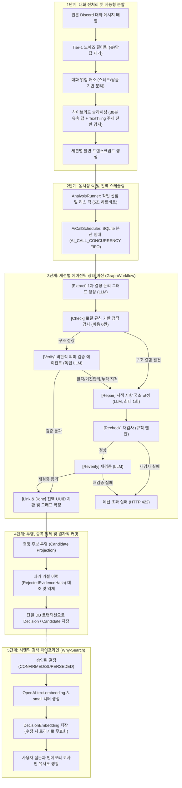

# GGADDAK AI 동작 로직 및 의사결정 파이프라인 명세 (AI Operation Logic)

이 문서는 GGADDAK 백엔드(`apps/be`)와 공유 라이브러리(`packages/shared`)에 구현된 **AI 동작 로직, 토론 전처리 엔진, 에이전틱 자기 교정 파이프라인, 전역 동시성 제어 및 시맨틱 검색 메커니즘**을 총망라하여 설명하는 기술 명세서입니다.

---

## 1. 개요 및 AI 설계 철학

GGADDAK의 AI 파이프라인은 단순히 대화 텍스트를 LLM에 전달하고 요약을 받아오는 단발성(One-shot) 호출 방식을 지양하며, 신뢰성 높은 의사결정 기록(Decision Record)을 생성하기 위해 다음과 같은 **핵심 원칙**을 엄격히 준수합니다.

1. **대화는 지시가 아닌 데이터 (Data, not instructions)**:
   - 사용자의 Discord 대화에 프롬프트 인젝션이나 오해의 소지가 있는 지시 문구가 포함되어 있더라도, AI 모델은 이를 실행 지시로 받아들이지 않고 순수 관찰 데이터로만 격리 처리합니다.
2. **다단계 자기 교정 루프 (Self-Correction Loop)**:
   - 생성자(Extract), 규칙 검사기(Check), 비판적 검증자(Verify), 교정자(Repair)가 단계별로 상호 검증하여 날조(환각), 거짓 합의, 대안 누락을 차단합니다.
3. **엄격한 자원/비용 예산 통제 (Bounded Budget)**:
   - 무한 루프나 과도한 API 토큰 소모를 방지하기 위해 세션당 최대 1회의 교정(`maxRepairs: 1`), 최대 4회의 논리적 호출(`maxLogicalCalls: 4`), 전체 세션 타임아웃 예산을 강제합니다.
4. **결정론적 체크포인트와 원자적 발행 (Atomic Publication)**:
   - 세션 단계마다 DB에 체크포인트를 기록하여 워커 장애 시 안전하게 재개하며, 전체 세션 검증이 모두 통과해야 최종 결과가 사용자에게 노출됩니다.

---

## 2. 전체 AI 파이프라인 흐름도

---

## 3. 세부 단계별 동작 로직 상세

### 3.1. [1단계] 대화 전처리 및 주제별 세션 분할

- **관련 코드**: [extractor-core.ts](file:///Users/wooddang-mac/Desktop/code/5.%20toy/GGADDAK/apps/be/src/engine/extractor-core.ts), [discussion-preprocessing.ts](file:///Users/wooddang-mac/Desktop/code/5.%20toy/GGADDAK/apps/be/src/services/discussion-preprocessing.ts)
- **모듈 클래스**: `DecisionExtractorCore`

#### (1) 노이즈 필터링 (`filterTier1Messages`)

- 봇이 보낸 메시지 및 슬래시 커맨드 접두어(`!`, `/`, `$` 등) 제거.
- 의미 없는 단순 감탄사나 1~2자 단답 필터링.
- 메시지에 부착된 사용자 이모지 반응(Reactions)은 지지/동의의 가중치 데이터로 보존.

#### (2) 대화 얽힘 해소 (`disentangleConversations`)

- 디스코드의 특성상 동일 채널 내에서 2개 이상의 대화가 교차 진행되는 현상을 분리.
- `replyingToId`, 멘션 대상, 시간적 연속성(60초 이내 연속 발언 등)을 추적하여 분리된 논리 스레드(`DisentangledThreads`)로 묶음.

#### (3) 텍스트타일링(TextTiling) 기반 하이브리드 세션 슬라이싱 (`sliceSessionWithTopicDrift`)

대화를 모델의 컨텍스트 윈도우에 알맞게 나누고 문맥 오염을 막기 위해 2단계 분할을 수행합니다:

1. **30분 유휴 갭(Idle Gap)**: 대화 간격이 30분 이상 벌어지면 완전히 독립된 세션으로 1차 분할.
2. **블록 단위 TextTiling (16개 이상 메시지 대상)**:
   - 3개 메시지 단위로 텍스트 블록을 구성하고, 인접 블록 간 특징 벡터의 코사인 유사도(`computeCosineSimilarity`)를 계산.
   - 인접 유사도 곡선에서 깊이 점수(Depth Score)를 계산:
     $$\text{Depth} = (\text{Sim}_{i-1} - \text{Sim}_i) + (\text{Sim}_{i+1} - \text{Sim}_i)$$
   - `Depth >= 0.35`이거나 인접 유사도가 `0.2` 미만으로 급락하는 지점을 주제 전환(Topic Drift) 지점으로 판정하여 세션 분할.
   - 단일 세션 크기는 최소 1개, 최대 100개 메시지로 가드레일 강제.

#### (4) 거버넌스 점수 산출 (`calculateGovernanceScore`)

결정 후보의 합의 수준을 4단계(1.0 ~ 4.0)로 정량 평가:

- **1.0 (Incomplete)**: 근거(Rationale)가 10자 미만으로 결여된 불완전한 상태 (통과 실패).
- **2.0 (Weak)**: 1인 단독 통보이거나 참여자 간 상호 동의가 부족한 상태 (통과 실패).
- **3.0 (Standard)**: 2인 이상 참여 또는 복수 반응 + 명확한 근거가 제시된 표준 결정 (통과).
- **4.0 (Strong)**: 2인 이상 참여 + 2개 이상 동의 반응 + 구체적 근거(20자 이상) + 후속 실행 과제(Action Items) 완비 (통과).

---

### 3.2. [2단계] 실행 락 및 전역 AI 호출 조율

- **관련 코드**: [analysis-runner.ts](file:///Users/wooddang-mac/Desktop/code/5.%20toy/GGADDAK/apps/be/src/services/analysis-runner.ts), [ai-call-scheduler.ts](file:///Users/wooddang-mac/Desktop/code/5.%20toy/GGADDAK/apps/be/src/services/ai-call-scheduler.ts)

#### (1) 채널 직렬화 및 하트비트 갱신 (`AnalysisRunner`)

- 동일 채널에 대해 여러 분석 요청이 동시에 실행되는 것을 방지하기 위해 채널별 소유권 리스(`leaseUntil`)를 획득.
- 분석이 진행되는 동안 백그라운드 타이머(5초 간격)로 `leaseUntil`을 계속 연장. 프로세스 비정상 종료 시 리스가 만료되어 타 워커가 복구 가능.

#### (2) 분산 AI 호출 스케줄러 (`AiCallScheduler`)

- SQLite의 `AiCallLease` 테이블을 활용하여 다중 프로세스/워커 간의 전역 동시 AI 호출 상한(`AI_CALL_CONCURRENCY`, 기본값 1~32)을 엄격히 준수.
- 선입선출(FIFO) 기반 호출 허가(Permit) 발급.
- **계측 분리**: 큐에서 호출 허가를 기다린 대기 시간(`waitMs`)과 실제 모델이 응답을 생성한 시간(`elapsedMs`)을 분리하여 기록.
- **Fail-Fast 취소**: 세션 중 치명적 에러 발생 시 대기 중인 다른 작업들을 즉시 취소하고 프로세스 리소스를 신속히 정리.

---

### 3.3. [3단계] 세션별 에이전틱 상태 머신 (FSM)

- **관련 코드**: [graph-workflow.ts](file:///Users/wooddang-mac/Desktop/code/5.%20toy/GGADDAK/apps/be/src/services/graph-workflow.ts), [graph-prompt.ts](file:///Users/wooddang-mac/Desktop/code/5.%20toy/GGADDAK/apps/be/src/extractor/graph-prompt.ts), [ai.adapter.ts](file:///Users/wooddang-mac/Desktop/code/5.%20toy/GGADDAK/apps/be/src/adapters/ai.adapter.ts)

세션 분석은 독립된 유한 상태 머신(Finite State Machine)으로 실행되며 각 단계는 다음과 같습니다:

| 단계 (Phase)   | 실행 주체                 | 역할 및 주요 검증 사항                                                                                                                                                                                                                                                                                                                                                        |
| :------------- | :------------------------ | :---------------------------------------------------------------------------------------------------------------------------------------------------------------------------------------------------------------------------------------------------------------------------------------------------------------------------------------------------------------------------- |
| **`extract`**  | 생성 에이전트 (LLM)       | [GRAPH_SYSTEM_PROMPT](file:///Users/wooddang-mac/Desktop/code/5.%20toy/GGADDAK/apps/be/src/extractor/graph-prompt.ts) 기반으로 원본 대화에서 노드(`Topic`, `Issue`, `DecisionCandidate`, `Alternative`, `Rationale`, `ActionItem`)와 엣지를 1차 추출.                                                                                                                         |
| **`check`**    | 정적 규칙 엔진 (비용 0원) | [GraphSchema](file:///Users/wooddang-mac/Desktop/code/5.%20toy/GGADDAK/apps/be/src/domain/decision-graph.ts) 유효성 검사, 고아 노드 검출, 잘못된 엣지 연결(예: Rationale이 Topic을 가리킴), 노드 ID 중복 등을 AI 호출 없이 로컬에서 신속 검사. 결함 시 즉시 `repair`로 전이.                                                                                                  |
| **`verify`**   | 비판적 검증자 (독립 LLM)  | [VERIFICATION_PROMPT](file:///Users/wooddang-mac/Desktop/code/5.%20toy/GGADDAK/apps/be/src/extractor/graph-prompt.ts)를 사용해 원문 대조 검증. 1. **날조(Invented Facts)**: 원문에 없는 근거/담당자/기한 날조 여부 2. **거짓 합의(False Consensus)**: 논쟁 중인 사안을 독단적으로 합의 처리했는지 여부 3. **누락(Omissions)**: 주요 대안이나 철회된 제안의 누락 여부 |
| **`repair`**   | 자기 교정자 (LLM)         | 검사기/검증기가 지적한 구체적 피드백(`issues`)과 기존 그래프를 입력받아 지적된 결함만 국소 수정. **기존 노드/엣지 ID 보존 강제**. 세션당 **최대 1회(`maxRepairs: 1`)만 허용**되며, 추가 결함 시 예산 초과(422)로 종료.                                                                                                                                                        |
| **`recheck`**  | 정적 규칙 엔진 (비용 0원) | 교정된 그래프의 스키마 및 무결성을 재검사.                                                                                                                                                                                                                                                                                                                                    |
| **`reverify`** | 비판적 검증자 (독립 LLM)  | 교정된 그래프가 원문 대화의 의미를 왜곡하지 않았는지 최종 재검증.                                                                                                                                                                                                                                                                                                             |
| **`done`**     | ID 링커 (로컬)            | 모델이 반환한 임시 ID(`node:1`, `edge:2`)를 전역 고유 UUID로 치환하고 최종 `GraphSession`을 확정.                                                                                                                                                                                                                                                                             |

---

### 3.4. [4단계] AI 실행 어댑터 (NVIDIA Provider & AGY Provider)

- **관련 코드**: [nvidia-provider.ts](file:///Users/wooddang-mac/Desktop/code/5.%20toy/GGADDAK/apps/be/src/adapters/nvidia-provider.ts), [agy-provider.ts](file:///Users/wooddang-mac/Desktop/code/5.%20toy/GGADDAK/apps/be/src/adapters/agy-provider.ts), [ai.adapter.ts](file:///Users/wooddang-mac/Desktop/code/5.%20toy/GGADDAK/apps/be/src/adapters/ai.adapter.ts)

GGADDAK 백엔드는 `AI_PROVIDER` 설정에 따라 NVIDIA NIM API 및 Antigravity CLI(`agy`)를 지원하는 멀티 프로바이더 어댑터를 탑재하고 있습니다:

1. **NVIDIA NIM HTTP Provider (`nvidia`, 기본값)**:
   - OpenAI 호환 SDK(`openai`)를 통해 `https://integrate.api.nvidia.com/v1` 엔드포인트와 통신합니다.
   - 기본 모델은 `nvidia/nemotron-3.5-super-vl-120b-a12b`이며, 16,384 토큰 및 20초 타임아웃 기본 정책을 가집니다.
   - `NVIDIA_ENABLE_THINKING` 옵션(기본값 `true`)을 통해 사고 과정(`reasoning_content`)을 수집하고 디버그 로그에 기록합니다.
   - 20초 타임아웃 초과 시 숨겨진 폴백 없이 `503 Service Unavailable`로 전파하여 상위 큐에서 투명하게 재시도를 관리합니다.
2. **에이전트 샌드박스 (`agy`)**:
   - 매 호출마다 임시 디렉토리(`mkdtemp`)를 생성하고, 파일 읽기/쓰기, 셸 명령, 웹 브라우징, 도구 호출 권한을 일체 박탈한 단일 기능 에이전트 매니페스트를 동적 생성합니다.
   - 오직 구조화된 JSON 결과 반환 종료 도구(`tools: [finish]`)만 허용됩니다.
3. **엄격한 Zod 스키마 강제**:
   - `GraphSchema`와 `VerificationSchema`를 JSON Schema로 변환하여 공급자에 전달하며, 정규화 파서(`extractAndParseJson`)를 통해 마크다운 코드블록 제거 후 정형 JSON 결과를 확정합니다.

---

### 3.5. [5단계] 시맨틱 검색 파이프라인 (Why-Search)

- **관련 코드**: [search.service.ts](file:///Users/wooddang-mac/Desktop/code/5.%20toy/GGADDAK/apps/be/src/services/search.service.ts), [WHY-SEARCH.md](file:///Users/wooddang-mac/Desktop/code/5.%20toy/GGADDAK/apps/be/WHY-SEARCH.md)

승인된 결정 카드(CONFIRMED) 및 대체된 과거 결정(SUPERSEDED)에 대해 자연어 의미 기반 검색을 제공합니다.

1. **임베딩 모델**: OpenAI `text-embedding-3-small` (1536차원 벡터) 사용.
2. **저장 및 캐싱**:
   - SQLite `DecisionEmbedding` 테이블에 `vectorJson`, `contentHash`, `model`을 저장.
   - 결정 카드가 편집되거나 변경되면 DB 트리거 및 리포지토리 로직에 의해 기존 임베딩이 즉시 무효화(삭제)되며, 다음 검색 시점에 지연 재생성(On-demand Refresh)됩니다.
3. **유사도 랭킹**:
   - 사용자가 입력한 자연어 질문 벡터와 해당 길드 내 대상 결정 카드들의 벡터 간 **코사인 유사도(Cosine Similarity)**를 인메모리에서 계산.
   - 양수 유사도(`score > 0`)를 가진 결과를 유사도 내림차순으로 정렬하여 반환.

---

## 4. AI 관련 환경 변수 및 설정 정책

| 환경 변수명              | 기본값                   | 설명                                                 |
| :----------------------- | :----------------------- | :--------------------------------------------------- |
| `AI_PROVIDER`            | `agy`                    | AI 공급자 엔진 (`agy`, `mock` 지원)                  |
| `AI_MODEL`               | `gemini-2.5-pro`         | 기본 AI 분석 모델 식별자                             |
| `AI_CALL_CONCURRENCY`    | `1`                      | 서버 전체에서 허용되는 최대 동시 AI 호출 수 (1 ~ 32) |
| `AI_SESSION_CONCURRENCY` | `1`                      | 단일 분석 요청 내에서 병렬 처리할 세션 수 (1 ~ 32)   |
| `AI_MAX_OUTPUT_TOKENS`   | `8192`                   | 모델 생성 최대 출력 토큰 수                          |
| `AI_MAX_INPUT_CHARS`     | `0` (무제한)             | 단일 호출 시 허용되는 최대 입력 문자 수 가드레일     |
| `EMBEDDING_PROVIDER`     | `openai`                 | Why-Search 시맨틱 임베딩 제공자                      |
| `EMBEDDING_MODEL`        | `text-embedding-3-small` | 시맨틱 임베딩 모델명                                 |
