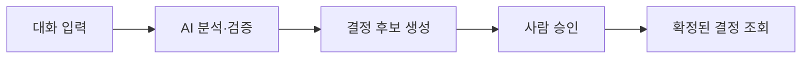

# 중간 리뷰 제출 자료 — BE·Discord Bot

기준일: 2026-11-03 · 본문 5장 · 발표 약 3분

취합 범위: BE와 Bot 구현·검증·시연 준비. 기획·디자인은 해당 담당자가 정리하며, 별도 FE의 화면 구현 실적은 포함하지 않습니다.

## 1장. 주요 기능 구현 현황 — 대화에서 결정 기록까지

**Discord 대화를 분석해 결정 후보를 만들고, 사람이 검수한 결과를 저장·조회하는 흐름을 구현했습니다.**

| 기능 | 구현 현황 |
| --- | --- |
| Discord 대화 수집·분석 전달 | Bot 수집, 영속 수신 큐, 실패 전달 재시도 구현 |
| AI 결정 후보 생성 | 추출 → 구조 검사 → 의미 검증 → 필요 시 최대 1회 수정 |
| 사람의 검수 | 승인·수정·거절·기존 결정 대체, 버전 충돌 검사 |
| 결정 활용 API | 목록·상세·이력·타임라인·Dashboard·Why 검색 |
| 서버 설정·접근 보호 | 봇 설치 상태, 감시 채널 설정, 가입 서버별 접근 검사 |

실제 AI 공급자 연결과 소규모 합성 한국어 대화 분석도 확인했습니다. 실사용 대화에 대한 정확도 평가는 남아 있습니다.

**발표 멘트**

“백엔드와 봇은 대화를 수집해서 결정 후보를 만들고, 사람이 검수한 기록을 저장하고 조회하는 흐름을 구현했습니다. 후보 생성 뒤에는 구조와 의미를 검증하고, 실제 AI 공급자 연결도 소규모 대화로 확인했습니다.”

---

## 2장. 구현 기능 시연 — 입력 → 후보 → 승인 → 조회

| 시연 단계 | 보여줄 내용 |
| --- | --- |
| ① 대화 입력 | 선택지와 선택 이유가 포함된 짧은 예시 대화 |
| ② 후보 확인 | 결정 내용·근거·후속 작업이 포함된 Draft 후보 |
| ③ 승인 | 사람이 후보를 확인하고 승인하는 요청 |
| ④ 조회 | 승인한 결정이 목록·상세에 반영된 결과 |

**현재 근거:** 고정 AI 응답을 사용하는 자동 통합 테스트에서 전체 API 흐름을 검증했습니다. 실제 AI 연결은 별도 소규모 분석 기록으로 확인했습니다. 실제 Discord→AI→별도 FE까지 연결한 운영 전체 시연과 녹화 완료는 아직 확인되지 않았습니다.

**발표 멘트**

“시연은 대화 입력, 후보 확인, 승인, 최종 조회 순서로 준비합니다. API 전체 흐름은 자동 테스트에서 확인했고, 실제 Discord와 최종 프론트 화면을 함께 연결하는 시연은 데모데이 전 점검 항목입니다.”

---

## 3장. QA·테스트 — 서버 격리와 장애 복구까지 확인

2026-11-03 전체 실행 기록 기준입니다. 발표 자료 작성 때문에 테스트를 새로 실행한 수치는 아닙니다.

| 검증 범위 | 결과 |
| --- | --- |
| BE | 175개 통과 |
| Bot | 53개 통과 |
| E2E | 9개 통과 |
| 참고: 저장소 데모 FE | 21개 통과, 별도 FE의 검증 결과와 구분 |
| 타입 검사·코드 검사 | 타입 검사 통과, lint 오류 0건·기존 경고 1건 |

- 다른 서버 ID·결정 ID를 넣어도 데이터 접근이 차단되는지 확인했습니다.
- 탈퇴·권한 변경, SDK 캐시에 없는 멤버, 재접속 중 재생 이벤트를 검증했습니다.
- 중복 요청·재시작·전달 실패·늦게 완료된 권한 조회의 복구를 검증했습니다.
- 화면을 열어둔 동안 주기적으로 권한을 조회하지 않고, JWT 갱신과 권한 재검증을 분리했습니다.

**발표 멘트**

“정상적인 처리뿐 아니라 다른 서버 접근 차단, 탈퇴와 재접속, 중복 요청과 장애 복구를 자동 검증했습니다. 다만 이 테스트 수가 AI의 추출 정확도를 뜻하는 것은 아니며, 실제 사용자 대화에 대한 품질 확인은 별도로 진행해야 합니다.”

---

## 4장. 최종 발표 구성·시연 계획

**사용자의 대화가 검수된 결정 기록으로 남는 과정을 한 사례로 보여줍니다.**

1. 기획·디자인 담당자가 문제와 사용자 경험을 소개합니다.
2. BE·Bot은 대화 수집 → 분석 → 후보 생성 흐름을 설명합니다.
3. 사람이 승인한 뒤 결정 기록을 다시 조회하는 결과를 보여줍니다.
4. QA 결과와 실제 적용을 위해 남은 작업을 공유합니다.

| 준비 순서 | BE·Bot 준비물 |
| --- | --- |
| 시연 내용 고정 | 예시 대화 1개, 확인할 후보·근거·승인 결과 |
| API 시연 점검 | Swagger 또는 API 요청 도구로 입력·검수·조회 순서 확인 |
| FE 연동 확인 | 실제 연결이 확인된 구간부터 화면 시연으로 교체 |
| 발표자 전달 | 30~60초 시연 녹화, 화면 캡처, 단계별 설명문 준비 |

위 항목은 **준비 계획**입니다. 녹화 파일과 최종 화면 시연이 이미 완성됐다는 의미는 아닙니다.

**발표 멘트**

“최종 발표는 하나의 논의가 결정 기록이 되는 과정을 중심으로 구성합니다. 먼저 API 시연을 고정하고, 프론트 연결이 확인된 부분은 실제 화면으로 바꾸겠습니다. 발표자가 바로 사용할 수 있도록 짧은 녹화와 설명문도 준비할 계획입니다.”

---

## 5장. 데모데이 전 보완할 사항

| 우선순위 | 보완 사항 | 완료 판단 기준 |
| --- | --- | --- |
| 필수 | 배포 DB·Discord 설정 적용 확인 | 선택 DB 백업·신규 migration, 필요한 Portal·Bot 설정 확인 |
| 필수 | 실제 환경 전체 흐름 점검 | 실제 Discord 대화 → AI 후보 → 사람 검수 → 결정 조회 성공 |
| 필수 | 실제 FE 연동 범위 확정 | 인증·서버 선택·후보 조회·검수·결정 조회의 연결 결과 확인 |
| 필수 | 시연 대화의 AI 품질 점검 | 선택·근거가 원문과 일치하고 없는 내용을 생성하지 않는지 확인 |
| 필수 | 시연 자료 확정 | 같은 사례로 재현한 녹화·캡처를 발표자에게 전달 |
| 후속 | 서버별 웹 External Feedback | 별도 사용자 인증·서버 소유권 계약 후 진행 |

**발표 멘트**

“남은 핵심은 새 기능을 늘리는 것보다, 실제 Discord·AI·프론트가 연결된 환경에서 동일한 사례가 끝까지 동작하는지 확인하는 것입니다. 배포 설정과 시연 품질을 먼저 점검하고 결과를 녹화해 전달하겠습니다.”

## 취합 담당자에게 보낼 요약

> BE·Discord Bot은 대화 수집, AI 결정 후보 추출·검증, 사람의 검수, 결정 기록 조회 API까지 구현했습니다. 자동 테스트는 BE 175개, Bot 53개, E2E 9개가 통과했으며 서버별 권한 격리와 장애 복구도 검증했습니다. 실제 AI 공급자 연결과 소규모 합성 대화 분석은 확인했습니다. 중간 리뷰에는 API 중심의 입력→후보→승인→조회 흐름을 공유하고, 데모데이 전 실제 Discord·FE 전체 연동과 시연 대화의 AI 품질을 점검한 뒤 녹화 자료를 전달할 계획입니다.

## 발표자 참고 — 근거와 시연 요청 순서

아래는 슬라이드 본문에 넣지 않아도 되는 확인 자료입니다.

| 확인 내용 | 근거 |
| --- | --- |
| API 전체 흐름 자동 검증 | [E2E 테스트](../tests/e2e/e2e.test.ts) — AI·Discord 인증은 고정 응답 사용 |
| 실제 AI 공급자 연결·소규모 합성 대화 | [AGY 연결 확인 기록](research/agy-cli-integration.md) |
| 테스트 수·권한 복구·남은 적용 항목 | [최종 검증 기록](../.scratch/guild-access-hardening/verification.md) |
| FE와 공유할 계약 | [FE API 연동 문서](api/frontend-api.md) |
| Bot 전달·서비스 인증 계약 | [내부 API 문서](api/internal-api.md) |
| 상세 아키텍처 부록 | [기존 개발 발표 자료](presentation.md) |

API 시연은 인증된 Bot 입력 `POST /api/discussions/analyze`, 사용자 후보 조회 `GET /api/v1/review-queue?guildId=...`, 검수 `POST /api/v1/review-queue/{ticketId}/review`, 결정 조회 `GET /api/v1/decisions?guildId=...` 순서로 구성할 수 있습니다. 실제 body·버전·검수 필드는 생성된 Swagger와 FE 계약을 사용합니다. 후보 생성과 최종 승인 결과를 함께 보여주며, 응답을 사전에 만든 경우에는 고정 응답 시연임을 표시합니다.
