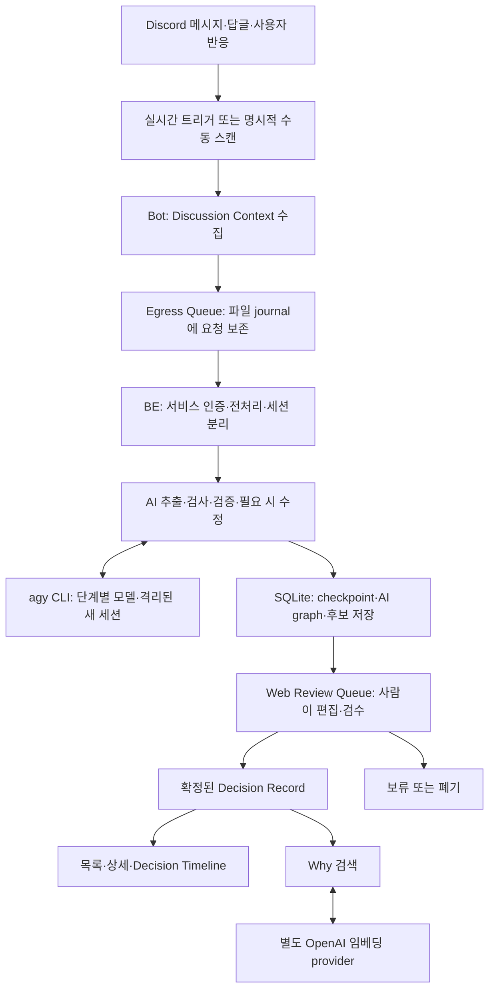
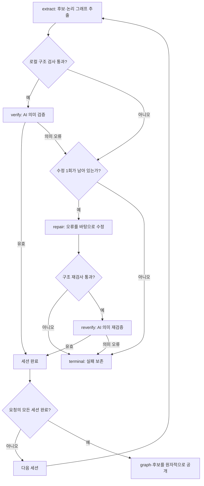
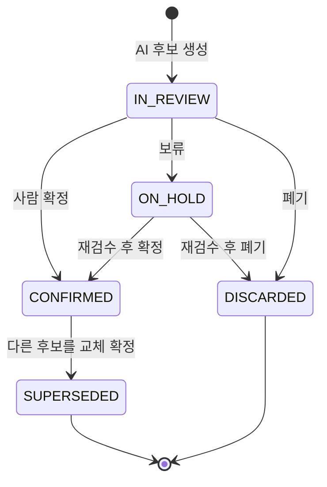
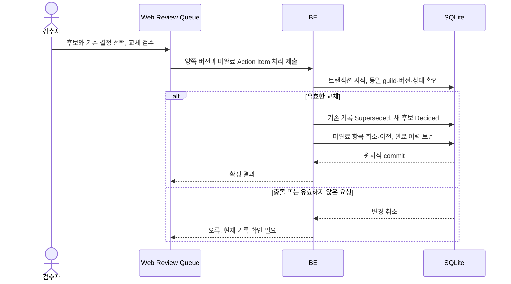
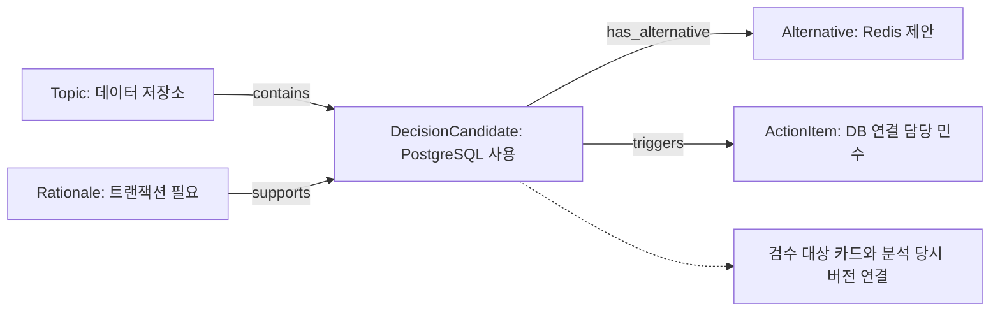

# 의사결정 기능과 AI 분석 흐름

기준일: 2026-10-15. 마지막 구현 기준: `2cc3cf3`.

Discord 대화에서 AI가 **Decision Candidate**를 추출하고, 사람이 Web Review Queue에서 확정하면 **Decision Record**가 된다. 대화에서 관찰한 합의(`agreed`)와 사람의 확정(`CONFIRMED`)은 서로 다른 값이다. 이 문서는 현재 구현, 검증한 범위, 남은 운영 준비를 구분한다.

## 전체 흐름



Bot 시작이나 새 서버 초대가 과거 대화 전체 스캔을 자동 생성하지 않는다. 과거 대화는 명시적 스캔/Sync Job으로 검사하며, 기존 보관 요청의 복구와 새 대화 추적은 유지한다. 기본 분석 전송은 agy이며 Gemini/OpenAI HTTP도 명시적 provider 설정으로 지원한다. 장애 시 다른 provider로 자동 전환하지 않는다.

## 구현 기능

| 영역 | 현재 동작 | 범위·관련 문서 |
| --- | --- | --- |
| 수집 | 모니터링 채널, 의미·키워드·사용자 반응·수동 트리거, 앞뒤 메시지·답글·반응 수집, 채널별 debounce·직렬화 | Bot의 처리 표시 반응을 사람의 합의로 세지 않음 |
| 과거 동기화 | 수동/전체 동기화, 진행률·실패 상태, Channel Checkpoint와 재시작 복구 | [전달·스캔 경계](adr/0020-analysis-delivery-and-scan-coverage.md) |
| 전처리 | 노이즈 필터, 짧은 동의·반응 처리, 얽힌 대화와 시간 공백·주제 변화에 따른 세션 분리 | 분석 단위는 입력 Discussion Context 내부 |
| AI 추출 | 후보, 대안, Rationale, Action Item, 담당자·기한, 합의·철회 관찰 보존 | 미언급 근거·담당자·기한을 만들지 않음 |
| 논리 그래프 | 노드·관계·문제 기록, 분석 당시 snapshot, 권한 검사된 graph API | [분석·graph 계약](api/agentic-analysis.md). 전용 그래프 시각화 화면은 없음 |
| 모델 선택 | 기본 모델과 추출/검증/수정별 모델, 요청 시작 시 설정 snapshot | 복잡도에 따른 자동 선택·승격은 없음 |
| 검수 | 확정·보류·폐기, 검수자·확정 시각, 오래된 버전과 중복 검수 거절 | [사람의 확정 경계](adr/0019-web-owned-decision-review.md) |
| 교체 | 기존 기록 Supersede, 미완료 Action Item 취소·이전, 완료 이력 유지, Independent Retention | 후보·기존 기록의 버전과 상태를 한 트랜잭션에서 검사 |
| 편집·이력 | 카드·근거·대안·Action Item 편집, 변경 이력·버전 충돌 검사 | [편집 계약](model/decision-edit.md). AI snapshot은 보존 |
| 중복·복구 | Evidence Hash·후보 중복 억제, 폐기 근거 자동 재생성 차단, 명시적 재분석·실패 재시도 | 같은 요청의 전달 재시도와 새 요청의 재분석을 구별 |
| 조회·타임라인 | 서버별 목록·상세·필터·페이지, 월/주제/채널/카테고리 그룹, 기간·시간대, 원문 접기 | [조회](model/decision-read.md), [타임라인](model/decision-timeline.md) |
| Why 검색 | 자연어 임베딩 검색, 관련 기록·근거 발췌·Discord 출처, 영속 색인·갱신·복구 | [검색 운영](../apps/be/WHY-SEARCH.md). CONFIRMED·SUPERSEDED 대상, 유사도는 확률이 아님 |
| 요약·피드백 | 확정·보류·검수 대기 지표, 최근 결정·동기화 상태, 외부 피드백 입력·조회 | [요약 계약](model/dashboard-summary.md). 과거 결정·피드백을 AI가 자동 검색해 추론하지 않음 |
| 접근·저장 | Discord 로그인, 주요 v1 API의 guild 접근 검사, SQLite/Prisma, OpenAPI·FE 생성 클라이언트 | [FE API 계약](api/frontend-api.md). legacy 피드백 경로 전체의 인증을 보장하는 설명은 아님 |

## AI 분석과 실패 분기

아래는 **한 세션**의 흐름이다. 요청에 여러 세션이 있으면 모두 성공한 뒤 후보를 원자적으로 공개한다. 뒤 세션이 실패해도 앞 세션의 카드만 부분 공개하지 않으며, 재개 시 완료한 세션은 보존한다.



통신 장애는 위의 의미 오류와 별도로 저장한 단계에서 재시도한다. 의미 검증 응답 자체가 잘못된 형식인 경우 등 모든 실패가 수정 분기로 들어가지는 않는다. API의 `found`는 반환 후보의 존재를 뜻하며, 합의나 사람의 확정을 뜻하지 않는다.

| 제한·복구 | 현재 구현 |
| --- | --- |
| 수정 | 세션당 최대 1회 |
| 논리 호출 | 세션당 최대 4단계: extract/verify/repair/reverify. 통신 재시도를 포함한 실제 CLI 시도 수 제한과 다름 |
| 실행 시간 | 시도당 최대 45초, 세션 누적 활성 실행 180초. 재시도 대기 제외, 재시작 시 사용량 유지 |
| 요청 전체 예산 | 여러 세션·재시도를 합친 실제 CLI 호출 수·누적 토큰/시간 제한은 아직 없음 |
| 재시도 | 일시 장애는 503과 저장 단계로 재개. 최종 검증·예산 실패는 422로 보존 |
| 동일 terminal 요청 | 재전송해도 AI를 재실행하지 않음. 의도적 재분석은 새 요청 ID 사용 |
| 외부 호출과 DB | 호출 완료 직후 checkpoint 저장 전 장애가 나면 추론이 반복될 수 있음. 외부 추론의 exactly-once를 보장하지 않음 |
| 공개 중복 방지 | 요청 소유권 검사와 트랜잭션으로 중복 공개 방지 |

### 모델 선택과 CLI 경계

```env
AI_PROVIDER=agy
AI_MODEL=gemini-3.8-flash-low
# 선택 예시: 검증·재검증에만 다른 모델 적용
AI_MODEL_VERIFY=gemini-3.8-flash-medium
# AI_MODEL_EXTRACT, AI_MODEL_REPAIR도 선택 가능
```

설정하지 않은 단계는 `AI_MODEL`을 사용한다. 설정 변경 후 BE를 재시작하면 새 분석부터 적용하고, 진행 중인 요청은 시작 시 저장한 설정을 사용한다. 각 시도의 provider·model·사용량을 보존한다. 기준일의 실제 로컬 설정은 단계별 override 없이 모든 단계 Low다. 위 Medium 설정은 사용 예시다.

agy는 BE OS 사용자의 기존 로그인으로 실행한다. 추가 npm 패키지 없이 Node 내장 기능으로 새 프로세스·임시 작업공간·구조화 응답을 연결했다. 에이전트 도구는 결과 제출용 `finish`만 허용하고 앱의 API/Bot 자격증명을 자식 환경에 전달하지 않는다. 취소·종료 시 프로세스 그룹을 정리한다. 임시 작업공간 삭제와 CLI 자체의 전역 대화 보관 정책은 별개다.

CLI 모드에는 정확한 입력 `countTokens` 사전 검사나 출력 토큰의 생성 전 강제 제한이 없다. 명시적 입력 토큰 preflight 제한은 오류로 거절하고, 출력 상한은 반환 usage를 사후 검사한다. 유료 계정 여부와 무관하게 CLI 자체 할당량과 모델 문맥 한계는 존재한다. HTTP Gemini의 토큰 사전 검사와 CLI 경로를 혼동하지 않는다. 상세: [agy 통합·실제 검증](research/agy-cli-integration.md), [HTTP 토큰 한계 조사](research/gemini-token-limits-2026-10-15.md).

## 사람의 검수와 결정 교체



위 상태는 v1 API 표시다. 저장 도메인의 `Draft/Proposed/Discussing`은 `IN_REVIEW`, `Deferred`는 `ON_HOLD`, `Decided`는 `CONFIRMED`, `Rejected`는 `DISCARDED`, `Superseded`는 `SUPERSEDED`에 대응한다. 수동 재분석은 폐기된 카드를 되살리는 대신 새 요청·후보를 만들며 기존 이력을 보존한다.



Independent Retention으로 확정하면 기존 기록의 상태를 바꾸지 않는다. Topic 일치는 비교 후보를 제공할 뿐 자동 충돌·교체·Pivot 판정이 아니다. 타임라인은 확정 시각이 있는 현재 확정 기록을 표시하고, Superseded 이력은 일반 조회·상세 및 Why 검색으로 확인한다.

## 논리 그래프와 카드의 관계



이 그림은 한국어 합성 검증 예시의 관계를 설명한다. Redis 제안을 채택된 결정으로 바꾸지 않으며 언급하지 않은 기한은 `null`이다. 실제 지원 노드는 Topic/Issue/DecisionCandidate/Alternative/Rationale/ActionItem, 관계는 contains/has_alternative/supports/opposes/triggers/conflicts_with/depends_on이다. 모순·순환은 discussionProblems에 기록한다.

AI graph는 분석 당시 snapshot이다. 카드 편집은 현재 카드와 변경 이력에 반영하며 graph를 덮어쓰지 않는다. graph 조회는 카드의 현재 버전과 snapshot의 차이를 표시한다. 자동 억제된 후보는 graph에 남을 수 있으나 새 카드를 만들지 않는다.

## 검증 기록과 운영 준비

구현 검증에서는 전체 워크스페이스 테스트(BE 108개·E2E 6개 포함), typecheck와 리뷰가 통과했다. 이는 직전 구현의 기록이며 이 문서 작업에서 같은 테스트를 다시 실행한 것은 아니다.

실제 agy 한국어 합성 대화로 분석과 임시 SQLite 저장·조회를 확인했다. PostgreSQL 합의와 그 근거, 미확정 Redis 제안, 담당자만 있는 Action Item을 보존했다. 모든 단계 Low 실행은 약 27.9초·입력 25,021/출력 598토큰, Low 추출/Medium 검증은 약 36.2초·입력 24,655/출력 1,420토큰이었다. 각각 수정 없이 2회 시도로 성공했다. 한 샘플의 성공과 사용량을 일반적인 정확도·비용 보장으로 해석하지 않는다.

2026-10-15 읽기 전용 로컬 점검에서 다음 운영 준비가 남아 있었다. 이 문서 작업에서는 DB나 환경 설정을 변경하지 않았다.

- 현재 DB에 `202610140001_agentic_analysis` migration이 미적용이다.
- `BOT_SERVICE_TOKEN`, Discord 웹 로그인 OAuth 설정이 없고 MonitoredChannel은 0건이다.
- 실제 Discord 수집 → Web Review Queue → 사람의 최종 확정까지의 연결 검증은 미완료다.
- 대표 한국어 gold 50개와 90% 품질 목표는 검증하지 않았다.

다음 단계로 실제 Discord부터 사람 확정까지의 검증을 우선하고, 단계별 명시적 모델 선택을 유지하며, 요청 전체 자원 예산을 추가하기로 합의했다. 실행 환경·예산 수치·소진 처리 정책은 아직 설계 중이다. [설계 인터뷰 기록](../.scratch/ai-agent-next-steps/map.md), [기능 점검 원본](../.scratch/decision-features-2026-10-15.md)을 참고한다.

## 운영 준비 후속 기록 — 2026-10-15

위 운영 점검 이후 루트 BOT_SERVICE_TOKEN을 설정하고 실제 서버의 내부 API 인증 200을 확인했다. 활성·legacy DB를 백업한 뒤 미적용 agentic migration을 적용했고, 기존 Decision 305건의 내용 보존과 DB 무결성을 검증했다. 모니터링 채널 선택과 실제 Discord 스캔 검증은 아직 남아 있다. 상세 절차와 시점별 결과는 [Discord 스캔 운영 기록](operations/discord-scan.md)을 따른다.

2026-10-16 후속 검증에서는 세 채널의 실제 메시지 186개·요청 4개 처리를 완료하고 후보 21건과 graph 4개를 저장했다. 후속 Sync Job은 3/3 완료·실패 0이며 기존 Decision 305건은 보존했다. 새 후보 모두 Review Queue의 조회 대상이다. 실제 사용자 브라우저 표시 확인과 사람의 최종 확정은 구분하며, 상세한 초기 실패 복구·집계 차이는 [운영 기록](operations/discord-scan.md)에 남겼다.
