# GGADDAK Backend Database Architecture & Schema Specification

이 문서는 GGADDAK 백엔드(BE)의 Prisma 스키마([schema.prisma](file:///Users/wooddang-mac/Desktop/code/5.%20toy/GGADDAK/apps/be/prisma/schema.prisma))와 리포지토리 계층 코드 분석을 바탕으로 작성된 데이터베이스 구조 및 ER 다이어그램 명세서입니다.

---

## 1. 개요 (Overview)

- **데이터베이스 엔진**: SQLite (WAL 모드, `DATABASE_URL` 환경 변수 기반)
- **ORM / 데이터 접근 계층**: Prisma Client + 리포지토리 패턴 (`BaseRepository`, 트랜잭션 및 리스 기반 Fencing 제어)
- **데이터 저장 전략**:
  - **정규화 메타 필드 + 불변 JSON**: `Decision`, `AnalysisRequest`, `SyncJob` 등은 빠른 검색/조회/인덱싱을 위해 핵심 상태값(`status`, `lifecycle`, `category`, `guildId` 등)을 컬럼으로 노출하고, 상세 객체는 유효성 검증을 거친 JSON 필드(`domainJson`, `resultJson`, `workflowJson`)에 저장합니다.
  - **분산 동시성 제어**: 다중 인스턴스/워커 환경에서 경합을 방지하기 위해 Optimistic Locking(`revision`), 시간 기반 임대(`leaseUntil`), 작업 소유자(`owner`, UUID) 펜싱 메커니즘을 사용합니다.

---

## 2. 전체 엔티티 관계도 (Global ER Diagram)

```mermaid
erDiagram
  %% ==========================================
  %% 1. 의사결정 및 지식 그래프 도메인
  %% ==========================================
  Decision ||--o| DecisionEmbedding : "has_embedding"
  Decision ||--o{ DecisionEdit : "has_edits"
  Decision ||--o{ CandidateIdentity : "identifies"
  Decision ||--o{ CandidateAnalysis : "classified_in"
  Decision ||--o{ CandidateRelation : "targets"
  CandidateAnalysis ||--o{ CandidateRelation : "defines"

  %% ==========================================
  %% 2. 분석 워크플로우 및 세션 동시성
  %% ==========================================
  AnalysisRequest ||--o{ CandidateAnalysis : "yields"
  AnalysisRequest ||--o{ AnalysisSessionState : "contains_sessions"

  %% ==========================================
  %% 3. 디스코드 인증 및 길드 접근 권한
  %% ==========================================
  User ||--o{ Membership : "belongs_to"
  Guild ||--o{ Membership : "has_members"
  User ||--o{ AuthSession : "owns_sessions"
  Guild ||--o{ MonitoredChannel : "monitors"

  %% ==========================================
  %% 4. 백그라운드 동기화 작업
  %% ==========================================
  SyncJob ||--|| SyncJobLock : "locks_guild"

  %% ==========================================
  %% 5. 주요 엔티티 필드 상세
  %% ==========================================
  Decision {
    string id PK
    string guildId "서버 격리 ID"
    string channelId "발생 채널 ID"
    string title "의사결정 제목"
    string status "Draft / InReview / Confirmed"
    string lifecycle "IN_REVIEW / CONFIRMED / SUPERSEDED"
    string category "기타 / 기술 / 운영 / 제품"
    string topic "토픽 클러스터"
    string domainJson "도메인 엔티티 전체 JSON"
    string evidenceHash "중복 방지 증거 해시"
    int version "수정 버전 번호"
    int storageVersion "스토리지 규격 버전"
    string supersedesId "대체 대상 결정 ID"
    string supersededById "후속 대체 결정 ID"
    datetime confirmedAt "최종 승인 일시"
    datetime createdAt "생성 일시"
    datetime updatedAt "수정 일시"
  }

  DecisionEmbedding {
    string decisionId PK,FK
    string model "임베딩 모델명"
    string contentHash "콘텐츠 해시"
    string vectorJson "임베딩 벡터 배열 JSON"
    datetime updatedAt "임베딩 갱신 일시"
  }

  DecisionEdit {
    string id PK
    string decisionId FK
    string actorId "수정한 사용자 ID"
    int version "수정 전 버전"
    string beforeJson "수정 전 결정 스냅샷"
    datetime createdAt "수정 일시"
  }

  CandidateIdentity {
    string key PK
    string decisionId FK
    string guildId "길드 ID"
    string channelId "채널 ID"
    string evidenceJson "증거 발언 데이터"
    string normalizedContent "정규화된 텍스트"
  }

  CandidateAnalysis {
    string requestId PK,FK
    string decisionId PK,FK
    string previousRequestsJson "이전 분석 요청 추적 JSON"
  }

  CandidateRelation {
    string requestId PK,FK
    string decisionId PK,FK
    string relatedDecisionId PK,FK
  }

  AnalysisRequest {
    string id PK
    string fingerprint "입력 페이로드 멱등성 해시"
    string guildId "길드 ID"
    string channelId "채널 ID"
    boolean manual "수동 트리거 여부"
    string state "Pending / Processing / Committing / Completed"
    string owner "현재 작업 소유 워커 UUID"
    datetime leaseUntil "작업 임대 만료 일시"
    string inputJson "요청 입력 JSON"
    string workflowJson "실행 워크플로우 메타데이터"
    string graphJson "추론된 의사결정 그래프 JSON"
    string resultJson "최종 분석 결과 JSON"
    string errorJson "장애 및 에러 상세 JSON"
    datetime createdAt "요청 접수 일시"
    datetime completedAt "작업 완료 일시"
  }

  AnalysisSessionState {
    string requestId PK,FK
    string id PK
    int position "세션 순서"
    string inputJson "세션 전처리 발언 입력 JSON"
    string stateJson "세션 중간 체크포인트 상태"
  }

  User {
    string id PK "디스코드 User ID"
    string username "사용자명"
    string avatar "아바타 해시"
    boolean guildsDirty "서버 목록 갱신 필요 플래그"
    datetime createdAt "가입 일시"
  }

  Guild {
    string id PK "디스코드 Guild ID"
    string name "서버명"
    string icon "아이콘 해시"
  }

  Membership {
    string userId PK,FK
    string guildId PK,FK
    boolean owner "서버 소유자 여부"
    string permissions "디스코드 권한 비트필드"
    int guildRevision "길드 권한 리비전"
    datetime refreshedAt "마지막 동기화 일시"
  }

  AuthSession {
    string id PK
    string userId FK
    string refreshToken "AES-GCM 암호화된 토큰"
    string browserTokenHash UK "브라우저 쿠키 인증 해시"
    string refreshOwner "토큰 갱신 소유권 UUID"
    datetime refreshLeaseUntil "갱신 락 만료 일시"
    int refreshVersion "갱신 세대 번호"
    datetime expiresAt "만료 일시"
    datetime refreshedAt "갱신 일시"
  }

  MonitoredChannel {
    string id PK "디스코드 Channel ID"
    string guildId FK "소속 Guild ID"
    string name "채널명"
    datetime updatedAt "수정 일시"
  }

  SyncJob {
    string id PK
    string guildId "길드 ID"
    boolean forceFullSync "전체 과거 내역 스캔 여부"
    string status "QUEUED / PROCESSING / COMPLETED / FAILED"
    string channelIdsJson "대상 채널 목록 JSON"
    string channelResultsJson "채널별 처리 결과 JSON"
    string owner "워커 소유권 UUID"
    int totalChannels "총 채널 수"
    int completedChannels "완료 채널 수"
    int failedChannels "실패 채널 수"
    int decisionsFound "발견된 결정 건수"
    int messagesScanned "스캔된 메시지 건수"
    string errorMessage "실패 사유"
    datetime leaseUntil "작업 임대 만료 일시"
    datetime createdAt "생성 일시"
    datetime completedAt "종료 일시"
  }

  SyncJobLock {
    string guildId PK
    string jobId UK
  }
```

---

## 3. 도메인별 상세 구조 및 테이블 역할

### 3.1. 의사결정 및 지식 그래프 도메인 (Decision Core & Graph)

토론 대화로부터 추출된 최종 의사결정과 상호 참조 관계를 관리합니다.

| 모델명                     | 주요 키/인덱스                                                                                                                                                                                                       | 핵심 필드                                                                                           | 기능 및 비즈니스 규칙                                                                                                                                         |
| :------------------------- | :------------------------------------------------------------------------------------------------------------------------------------------------------------------------------------------------------------------- | :-------------------------------------------------------------------------------------------------- | :------------------------------------------------------------------------------------------------------------------------------------------------------------ |
| **`Decision`**             | `PK(id)` `IDX(guildId, channelId)` `IDX(status)` `IDX(guildId, lifecycle, category, createdAt)` `IDX(guildId, lifecycle, confirmedAt)` `IDX(supersedesId)` `IDX(guildId, channelId, evidenceHash)` | `domainJson` `lifecycle` `category` `topic` `status` `evidenceHash` `confirmedAt` | 의사결정의 authoritative 레코드입니다. 전체 결정 객체는 `domainJson`에 직렬화되어 보관되며, 검색 및 대시보드 조회를 위한 핵심 필드가 컬럼화되어 인덱싱됩니다. |
| **`DecisionEmbedding`**    | `PK(decisionId)` `FK(decisionId -> Decision.id)`                                                                                                                                                                  | `model` `contentHash` `vectorJson`                                                            | 시맨틱 왜곡 없는 유사 의사결정 및 근거 검색(Why-Search)을 위한 벡터 임베딩 저장소입니다. 결정 삭제 시 Cascade 삭제됩니다.                                     |
| **`DecisionEdit`**         | `PK(id)` `UQ(decisionId, version)` `FK(decisionId -> Decision.id)`                                                                                                                                             | `actorId` `version` `beforeJson`                                                              | 대시보드/웹에서 사용자가 결정 카드의 내용이나 속성을 수정할 때 변경 전 스냅샷(`beforeJson`)을 기록하는 불변 감사 로그입니다.                                  |
| **`CandidateIdentity`**    | `PK(key)` `IDX(decisionId)` `IDX(guildId, channelId)`                                                                                                                                                          | `evidenceJson` `normalizedContent`                                                               | 원본 발언 데이터와 정규화된 텍스트를 기반으로 생성된 후보자의 고유 키를 관리하며, 중복 분석 발생 시 기존 결정을 연결합니다.                                   |
| **`CandidateAnalysis`**    | `PK(requestId, decisionId)` `FK(requestId -> AnalysisRequest.id)` `FK(decisionId -> Decision.id)`                                                                                                              | `previousRequestsJson`                                                                              | 분석 요청과 도출된 결정 간의 N:M 관계 테이블로, 재분석 시 과거 요청 내역을 추적합니다.                                                                        |
| **`CandidateRelation`**    | `PK(requestId, decisionId, relatedDecisionId)` `FK(requestId, decisionId -> CandidateAnalysis)` `FK(relatedDecisionId -> Decision.id)`                                                                         | `relatedDecisionId`                                                                                 | AI 그래프 추론 단계에서 도출된 결정 간의 인과/선후/대체 관계를 저장하는 유향 그래프 엣지(Edge)입니다.                                                         |
| **`RejectedEvidenceHash`** | `PK(evidenceHash)`                                                                                                                                                                                                   | `createdAt`                                                                                         | 의사결정 후보에서 탈락하거나 사용자가 기각한 증거 해시를 영구 보존하여 향후 동일 발언의 불필요한 재분석을 방지합니다.                                         |

---

### 3.2. AI 분석 파이프라인 및 동시성 제어 (Workflow & Concurrency)

LLM 추출 파이프라인(분석 -> 검증 -> 그래프 추론 -> 후보 발행)을 관리합니다.

| 모델명                     | 주요 키/인덱스                                                                            | 핵심 필드                                                                                            | 기능 및 비즈니스 규칙                                                                                                                                                                          |
| :------------------------- | :---------------------------------------------------------------------------------------- | :--------------------------------------------------------------------------------------------------- | :--------------------------------------------------------------------------------------------------------------------------------------------------------------------------------------------- |
| **`AnalysisRequest`**      | `PK(id)` `IDX(fingerprint)`                                                            | `fingerprint` `state` `owner` `leaseUntil` `workflowJson` `graphJson` `resultJson` | 하나의 토론 분석 트랜잭션을 나타냅니다. `fingerprint`를 통해 동일 입력 재요청 시 기완료된 결과를 즉시 반환(멱등성)하며, `owner`와 `leaseUntil`을 통한 분산 리스 락으로 중복 실행을 차단합니다. |
| **`AnalysisSessionState`** | `PK(requestId, id)` `UQ(requestId, position)` `FK(requestId -> AnalysisRequest.id)` | `position` `inputJson` `stateJson`                                                             | 긴 대화 세션을 분할하여 병렬 AI 분석을 수행할 때, 각 세션별 전처리 입력 및 진행 단계 체크포인트를 독립적으로 저장합니다.                                                                       |
| **`AiCallLease`**          | `PK(id)` `IDX(state, createdAt)`                                                       | `limit` `leaseUntil`                                                                              | AI 공급자(LLM) API 호출 시 전체 서버 프로세스 간의 호출 한도(Rate Limit / 동시 호출 수)를 준수하기 위한 전역 임대 락입니다.                                                                    |

---

### 3.3. 수집 큐 및 스캔 백프레셔 (Ingestion Queue & Backpressure)

봇으로부터 수신된 대용량 대화 범위를 유실 없이 안전하게 대기열에 적재합니다.

| 모델명                     | 주요 키/인덱스                                                                                   | 핵심 필드                                                                                   | 기능 및 비즈니스 규칙                                                                                                  |
| :------------------------- | :----------------------------------------------------------------------------------------------- | :------------------------------------------------------------------------------------------ | :--------------------------------------------------------------------------------------------------------------------- |
| **`AnalysisReceipt`**      | `PK(id)` `UQ(scanId, rangeIndex)` `IDX(state, nextAttemptAt)` `IDX(guildId, createdAt)` | `inputBytes` `state` `attempts` `nextAttemptAt` `leaseUntil` `errorCategory` | 봇에서 넘어온 대화 스캔 청크의 내구성 수신 영수증입니다. 백엔드 과부하 시 지수 백오프 및 재시도 스케줄링을 담당합니다. |
| **`AnalysisScan`**         | `PK(id)` `IDX(jobId)`                                                                         | `upperMessageId` `afterMessageId` `expectedRanges` `state`                         | 채널 대화 메시지 수집 범위와 분할된 청크 예상 개수를 추적하는 상위 스캔 메타데이터입니다.                              |
| **`AnalysisQueueControl`** | `PK(id = "queue")`                                                                               | `revision` `foregroundCount` `pauseUntil`                                             | 큐 소비 트랜잭션 충돌을 방지하는 원자적 리비전 카운터 및 큐 일시중지 제어 싱글톤입니다.                                |
| **`AnalysisExecution`**    | `PK(id)`                                                                                         | `owner` `requestId` `leaseUntil`                                                      | 단일 분석 실행 슬롯을 보장하는 인스턴스/프로세스 단위 실행 락입니다.                                                   |

---

### 3.4. 디스코드 인증, 세션 및 실시간 접근 제어 (Auth & Gateway Access)

디스코드 OAuth2 로그인, JWT 쿠키 세션 및 게이트웨이 권한 실시간 동기화를 담당합니다.

| 모델명                       | 주요 키/인덱스                                                              | 핵심 필드                                                                                    | 기능 및 비즈니스 규칙                                                                                                        |
| :--------------------------- | :-------------------------------------------------------------------------- | :------------------------------------------------------------------------------------------- | :--------------------------------------------------------------------------------------------------------------------------- |
| **`User`**                   | `PK(id)`                                                                    | `username` `avatar` `guildsDirty`                                                      | 디스코드 사용자 프로필입니다. 서버 목록 변경 시 `guildsDirty=true`로 표시되어 재동기화됩니다.                                |
| **`Guild`**                  | `PK(id)`                                                                    | `name` `icon`                                                                             | 봇이 설치되거나 사용자가 접근 가능한 디스코드 길드(서버) 정보입니다.                                                         |
| **`Membership`**             | `PK(userId, guildId)` `FK(userId -> User)` `FK(guildId -> Guild)`     | `owner` `permissions` `guildRevision` `refreshedAt`                                 | 사용자의 서버별 권한(비트필드) 매핑 테이블입니다. 보안을 위해 15분 후 자동 만료되어 재검증을 유도합니다.                     |
| **`AuthSession`**            | `PK(id)` `UQ(browserTokenHash)` `IDX(userId)` `FK(userId -> User)` | `refreshToken` `browserTokenHash` `refreshOwner` `refreshLeaseUntil` `expiresAt` | 암호화된 디스코드 토큰과 발급된 JWT 쿠키 해시를 바인딩합니다. 동시 토큰 갱신 경합을 방지하기 위한 리스 락 필드를 포함합니다. |
| **`OAuthState`**             | `PK(nonce)`                                                                 | `expiresAt`                                                                                  | 로그인 플로우의 CSRF 방지를 위한 5분 유효 단발성 Nonce 저장소입니다.                                                         |
| **`GuildAccessControl`**     | `PK(id = "discord")`                                                        | `streamId` `lastSequence` `connected` `membersIntent` `leaseUntil`               | 봇의 Discord Gateway 웹소켓 연결 상태 및 이벤트 시퀀스 추적 싱글톤입니다.                                                    |
| **`GuildAccessObservation`** | `PK(guildId)`                                                               | `installed` `available` `revision`                                                     | 각 서버별 봇 설치 상태(`installed` / `not_installed`) 및 가용성을 실시간 기록합니다.                                         |
| **`GuildAccessRemoval`**     | `PK(guildId, userId)`                                                       | `guildId` `userId`                                                                        | 추방/탈퇴된 사용자의 즉각적인 접근 차단을 위한 묘비(Tombstone) 레코드입니다.                                                 |

---

### 3.5. 백그라운드 채널 동기화 (Sync Jobs)

과거 대화 내역의 대규모 일괄 동기화(히스토리 스캔)를 관리합니다.

| 모델명                 | 주요 키/인덱스                                                     | 핵심 필드                                                                                     | 기능 및 비즈니스 규칙                                                                                                           |
| :--------------------- | :----------------------------------------------------------------- | :-------------------------------------------------------------------------------------------- | :------------------------------------------------------------------------------------------------------------------------------ |
| **`MonitoredChannel`** | `PK(id)` `IDX(guildId)` `FK(guildId -> Guild)`               | `name` `updatedAt`                                                                         | 길드 내에서 봇이 대화를 모니터링하도록 명시적으로 선택된 텍스트 채널 목록입니다.                                                |
| **`SyncJob`**          | `PK(id)` `IDX(guildId, createdAt)` `IDX(status, leaseUntil)` | `status` `channelIdsJson` `channelResultsJson` `decisionsFound` `messagesScanned` | 장기 실행 대화 동기화 작업입니다. 채널별 진행 상황과 실패 결과를 부분 보존하여 워커 재시작 시 실패한 채널만 이어할 수 있습니다. |
| **`SyncJobLock`**      | `PK(guildId)` `UQ(jobId)`                                       | `jobId`                                                                                       | 한 서버당 동시에 2개 이상의 동기화 작업이 실행되지 못하도록 보장하는 상호 배제 잠금입니다.                                      |

---

### 3.6. 결과 전달, 체크포인트 및 장기 아카이브 (Delivery & Retention)

분석 결과의 비동기 발행 및 레거시 데이터 마이그레이션 안전망을 제공합니다.

| 모델명                          | 주요 키/인덱스                          | 핵심 필드                                                | 기능 및 비즈니스 규칙                                                                    |
| :------------------------------ | :-------------------------------------- | :------------------------------------------------------- | :--------------------------------------------------------------------------------------- |
| **`AnalysisDelivery`**          | `PK(requestId)` `IDX(guildId)`       | `status` `attempts` `nextAttemptAt` `lastError` | 분석 완료된 결정 카드를 봇 웹훅/인터랙션으로 전달하기 위한 비동기 발송 대기열입니다.     |
| **`AnalysisRetryCommand`**      | `PK(id)` `IDX(acknowledgedAt)`       | `requestId` `guildId` `acknowledgedAt`             | 전송 실패한 분석 건에 대한 재전송 명령을 큐잉합니다.                                     |
| **`AnalysisDeliveryHeartbeat`** | `PK(id)`                                | `synchronizedAt`                                         | 전달 워커의 정상 작동 상태를 감시하는 헬스체크 테이블입니다.                             |
| **`ChannelCheckpoint`**         | `PK(channelId)`                         | `lastMessageId` `updatedAt`                           | 채널별로 가장 최근에 분석 처리가 완료된 디스코드 메시지 ID(스노우플레이크) 포인터입니다. |
| **`ExternalFeedback`**          | `PK(id)` `IDX(channelId, createdAt)` | `source` `content` `detail`                        | 슬랙, 지라, 깃허브 등 외부 도구에서 접수된 사용자 피드백 메타데이터입니다.               |
| **`StorageArchive`**            | `PK(kind, id)`                          | `dataJson` `createdAt`                                | 스키마 정규화/압축 과정에서 제외된 레거시 원본 데이터를 영구 보관하는 안전 저장소입니다. |

---

## 4. 동시성 제어 및 트랜잭션 격리 패턴

GGADDAK 백엔드는 분산 노드 및 다중 워커 환경에서 데이터 일관성을 유지하기 위해 아래 패턴을 엄격하게 적용합니다.

1. **소유권 임대 기반 Fencing (Lease Fencing)**:
   - `AnalysisRequest`, `SyncJob`, `AnalysisReceipt`는 `owner`(UUID)와 `leaseUntil`(Timestamp)을 조합하여 작업을 점유합니다.
   - 트랜잭션 진입 시 현재 `owner`가 일치하고 `leaseUntil > NOW()`인 경우에만 상태를 `Processing` 또는 `Committing`으로 전이할 수 있습니다.
2. **원자적 Optimistic Concurrency**:
   - `AnalysisQueueControl` 및 `GuildAccessControl`의 `revision` 정수 필드를 `update { revision: { increment: 1 } }` 형태로 증가시켜 동시 쓰기를 직렬화합니다.
3. **체크포인트 단조 증가 (Monotonic Progress)**:
   - `ChannelCheckpoint`는 새로운 `lastMessageId`가 이전 값보다 BigInt 기준으로 더 큰 경우에만 업데이트되어 과거 메시지로 역행하지 않습니다.
4. **외래키 삭제 제약 (`onDelete: Restrict`)**:
   - `Decision`, `CandidateAnalysis`, `CandidateRelation` 등 감사 추적이 필요한 엔티티는 실수로 상위 레코드가 삭제되어 데이터가 유실되지 않도록 `Restrict` 정책을 강제합니다. (사용자 탈퇴 등 계정 관련 데이터만 `Cascade` 적용)
