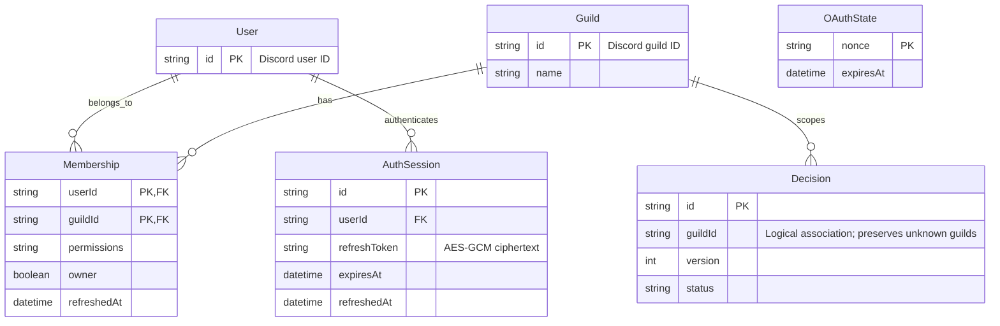

# v1 data model

User–Guild membership is persisted from Discord OAuth `guilds`, expires for authorization after 15 minutes, and is replaced on refresh. An AuthSession binds the JWT to a persisted user and encrypted Discord refresh credential. OAuthState is a browser-bound, five-minute, one-use nonce.

Decision.guildId remains its existing logical association rather than adding an immediate foreign key: the Bot may ingest a guild before a user logs in. The additive auth migration seeds Guild from existing Decision guild IDs and grants no memberships. Existing Decision, candidate history, Evidence Hash, feedback and checkpoint tables are retained.
