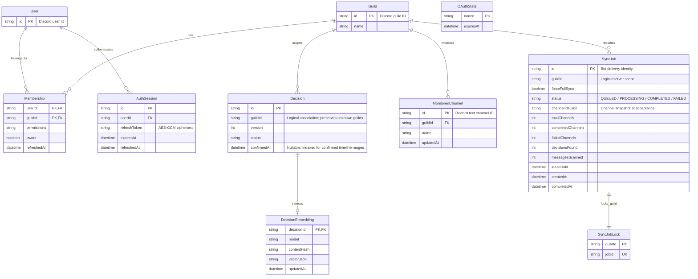

# v1 data model

User–Guild membership is persisted from Discord OAuth `guilds`, expires for authorization after 15 minutes, and is replaced on refresh. An AuthSession binds the JWT to a persisted user and encrypted Discord refresh credential. OAuthState is a browser-bound, five-minute, one-use nonce.

Decision.guildId remains its existing logical association rather than adding an immediate foreign key: the Bot may ingest a guild before a user logs in. The additive auth migration seeds Guild from existing Decision guild IDs and grants no memberships. Existing Decision, candidate history, Evidence Hash, feedback and checkpoint tables are retained.

Decision content edits and their additive audit model are documented in [Decision Card editing](../model/decision-edit.md). `updatedAt` and version expose edits without changing lifecycle or replacement links.

The [Decision Timeline](../model/decision-timeline.md) queries only confirmed records with a recorded confirmation timestamp. Missing historical dates remain null and are omitted from timeline groups; they remain available in Decision Card browsing. Confirmation timestamps are stored as UTC instants and grouped with an explicit IANA timezone.

MonitoredChannel is the persisted positive selection, replaced atomically per Guild. Discord channels are fetched live rather than cached as authoritative permission records. Bot reads revalidate ViewChannel and ReadMessageHistory, exclude threads/forums, and fail closed when Discord or BE is unavailable. Selection survives restarts and permission loss; inaccessible selections can only be removed until access is restored.

CORS_ORIGINS is an explicit comma-separated allowlist (default localhost:5173 and localhost:3000). Wildcard entries are ignored because authenticated browser requests include cookies. BOT_SERVICE_TOKEN must match in BE and Bot; it authenticates internal monitoring reads.

SyncJob snapshots the selected MonitoredChannel IDs when accepted. A per-guild lock rejects overlapping work with HTTP 409; the accepted job is persisted before HTTP 202. The Bot claims queued jobs with a renewable lease and records progress. An expired processing lease can be reclaimed after restart. Completed channels advance their Channel Checkpoint only after Analysis Request completion is acknowledged. `forceFullSync` scans all history and creates a stable, job-scoped Analysis Request identity so a retry after restart reuses the completed result; distinct jobs are intentional reanalysis and retain candidate identity/history rules.
