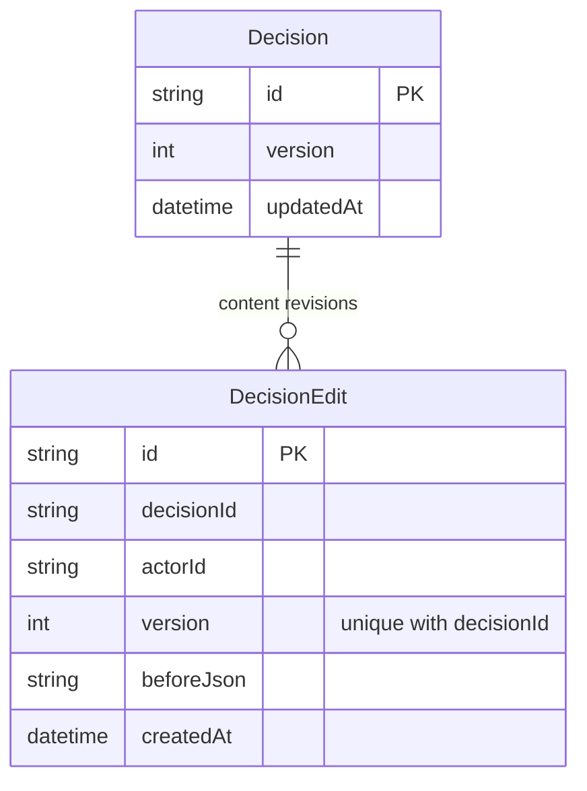

# Decision Card editing

`PUT /api/v1/decisions/{id}?guildId=...` requires an authenticated guild member and the version last read. All content fields are required: summary (`title`, 1–200 trimmed characters), decision and Rationale (1–10000), canonical category, and up to 20 alternatives. Alternatives require name (1–200) and reason (1–2000). The array replaces the previous array: preserve IDs to modify, omit IDs to add, omit an existing entry to delete. Duplicate and foreign IDs are rejected. Existing index IDs remain valid until replaced by persistent IDs; later reordering/deletion preserves retained IDs.

Content editing preserves Decision State, approval metadata, evidence, Action Items and Supersede links. Superseded and Rejected history is immutable. Unknown fields, including lifecycle fields, are rejected. Optimistic version updates and audit insertion share a transaction; stale edits return 409. `updatedAt` is returned on detail. DecisionEdit keeps the preceding complete content snapshot, actor, resulting version and timestamp; existing Decision rows are retained by an additive migration.

