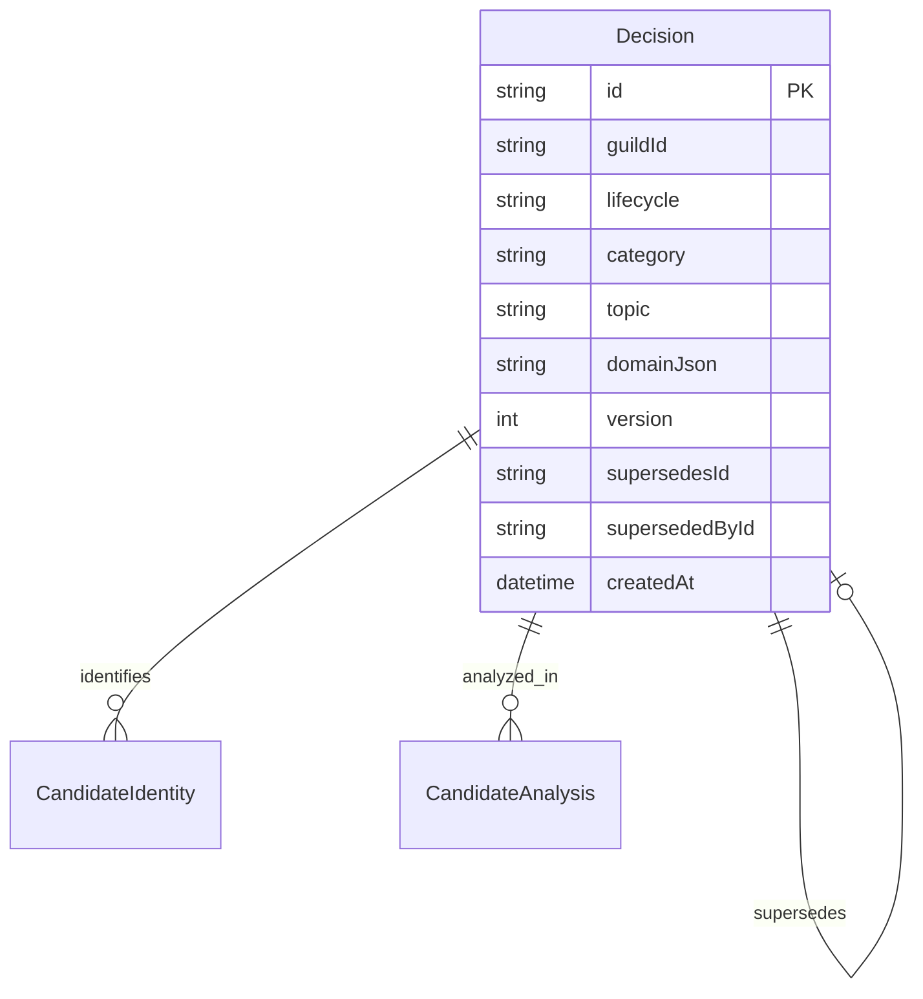

# Decision storage and v1 read contract

Decision Candidate and Decision Record use the same Decision table. The indexed lifecycle projection maps Draft/Proposed/Discussing to IN_REVIEW, Decided/confirmed to CONFIRMED, Deferred to ON_HOLD, and Rejected/rejected to DISCARDED. SUPERSEDED is separately queryable historical state; predecessor and replacement string IDs remain intact. Historical records are never silently treated as active confirmed records.

`domainJson` remains authoritative for complete existing domain payloads; `version` is authoritative in its column. Rows without domainJson use the legacy column compatibility decoder. New writes atomically update domainJson and all query projections (`guildId`, `topic`, `category`, `lifecycle`, `createdAt`) through DecisionRepository. The additive migration derives those projections from domainJson first and legacy columns second, preserving every original value. Missing historical confirmation dates and Action Items stay missing. Category values are 타깃, 문제정의, 기능, 기술, BM, 기타; historic labels remain readable. Dates are ISO 8601 UTC timestamps or null when unrecorded.

GET /api/v1/decisions requires guildId; status/category/topic filter in SQLite before descending creation date and ascending ID ordering and paging. page starts at 1, size defaults to 20 (maximum 100). Response includes items and pageInfo. The temporary decisions compatibility projection allows later feature tickets to migrate independently. GET /api/v1/decisions/{string ID}?guildId= returns complete evidence, alternatives, Action Items, source, version and replacement links. Alternative IDs use a stable decision ID/index projection; alternative name maps the retained option text. Authentication enforces server membership for both routes.

Verification: HTTP tests exercise filtered paging, full historical detail, invalid queries and guild isolation. The legacy migration test reads missing history correctly and persists Action Items through restart. `python3 apps/be/scripts/verify-decision-migration.py <existing SQLite path>` backs up the read-only source into a temporary copy, migrates and restarts the copy, and compares every original table/column. Verification on the existing Prisma SQLite database preserved all 305 decisions (304 IN_REVIEW, 1 CONFIRMED). No operating database was modified.
