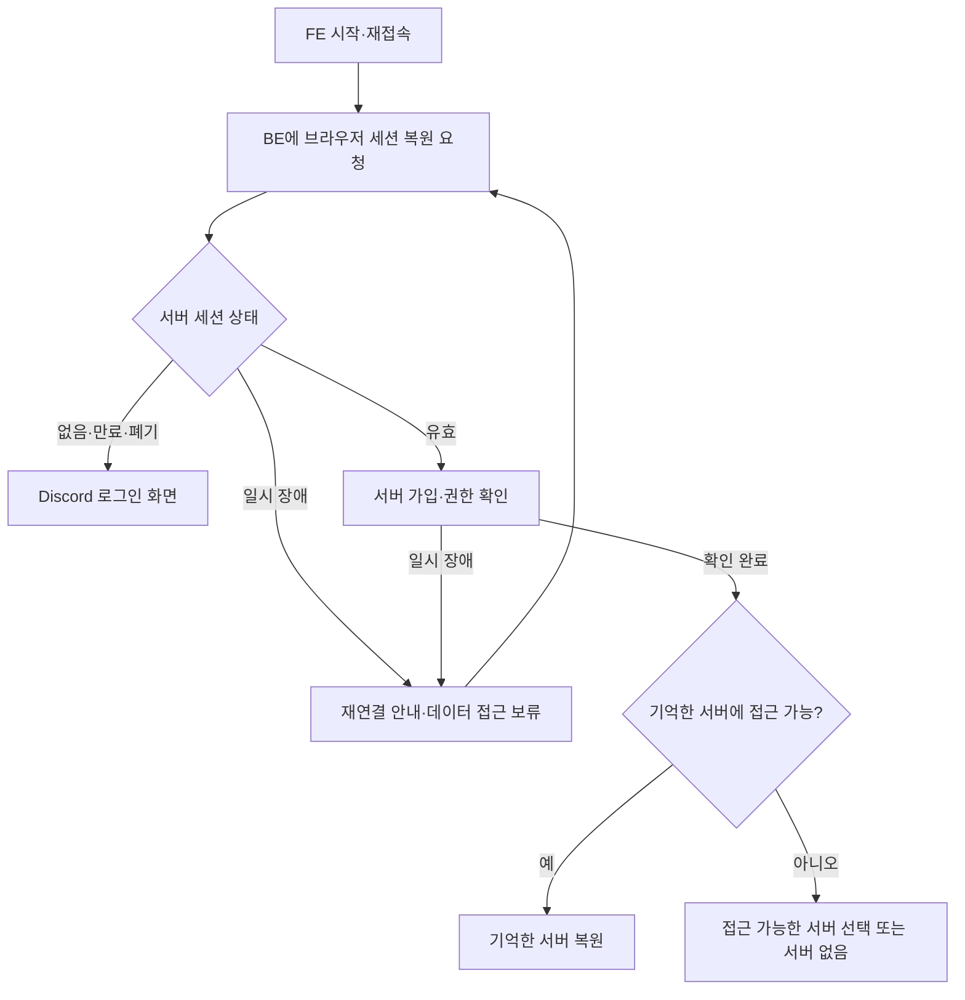

# 웹 로그인 주소와 지속 세션

2026-10-16. 상태: 구현·회귀 검증 완료, 실제 Discord Portal 콜백 등록 확인 대기. 현재 런타임 동작은 [인증 운영 문서](../../apps/be/AUTH.md)를 따른다. 지속 세션은 신규 로그인부터 적용된다. 마이그레이션 전 세션에는 복원 쿠키가 없어 한 번 새 로그인이 필요하다.

## 문제

기존 로컬 FE 포트 3000은 별도 Excalidraw 앱이 사용 중이다. 루트 로그인 콜백도 3000을 가리켜 Discord 인증 후 다른 앱으로 돌아간다. GGADDAK 자체의 의존성이나 기능으로 Excalidraw가 추가된 것은 아니다.

현재 FE는 access token을 메모리에만 저장하고 시작 시 세션 복원 절차가 없다. 새로고침·브라우저 재시작으로 메모리가 사라지면 DB AuthSession이 유효해도 로그인 화면으로 돌아간다. 기존 refresh API는 유효한 access JWT를 요구하므로 15분 이상 비활성화된 탭도 스스로 복구하지 못한다.

이 두 문제는 구분한다. 확인된 잘못된 앱 복귀와 세션 소실을 수정하되, 원인이 확인되지 않은 로그인 401까지 같은 원인으로 단정하지 않는다.

## 합의한 사용자 동작

- GGADDAK 로컬 FE는 3002를 사용한다. 콜백과 앱에서 안내하는 웹 주소도 일치시킨다. 다른 앱의 3000 프로세스는 종료하지 않는다. 포트 충돌 시 다른 포트로 조용히 이동하지 않는다.
- 같은 브라우저의 새로고침·탭 재생성·브라우저 종료 후 재실행에서도 로그인 상태를 복원한다.
- 최초 로그인 시점부터 고정 7일 뒤 만료한다. 활동할 때마다 무기한 연장하지 않는다.
- 현재 브라우저에서 로그아웃하면 같은 서비스의 다른 탭도 로그아웃한다. 다른 브라우저·기기의 별도 세션은 유지한다.
- 일시적인 네트워크·BE·Discord 장애는 재연결 상태로 안내한다. 그 사실만으로 세션을 폐기하지 않는다. 실제 만료·폐기된 세션은 다시 로그인한다.
- 세션 복원 시 Discord 서버 가입·권한을 확인한다. 확인되지 않은 동안 서버 데이터 조회·수정은 보류한다. 로그인 유지가 과거 권한의 무기한 사용을 뜻하지 않는다.
- 마지막 선택 서버는 현재 사용자에게 여전히 접근 권한이 있을 때 복원한다. 권한이 없으면 접근 가능한 다른 서버로 전환하고, 없으면 서버 없음 상태를 표시한다.

## 복원 흐름

## 구현 경계

기존 짧은 수명의 access JWT와 별도로, 브라우저가 읽을 수 없는 HttpOnly 지속 쿠키와 서버의 세션 복원 경로를 사용한다. Discord refresh token은 계속 BE에만 보관한다. access JWT 자체를 브라우저 영구 저장소에 넣어 수명만 늘리는 방식으로 구현하지 않는다.

브라우저 복원 자격증명은 예측 불가능한 값으로 발급하고 서버에는 검증용 해시를 저장한다. 쿠키의 실제 만료 시각은 최초 로그인부터 7일인 서버 세션 만료를 넘지 않는다. 로그아웃은 서버 세션 무효화·쿠키 삭제·메모리와 사용자 데이터 캐시 정리를 함께 수행한다.

쿠키 자동 전송 경로에는 SameSite·Secure·Path 설정과 Origin/CSRF 검사를 함께 설계한다. 동시 탭의 bootstrap·refresh가 Discord refresh credential 갱신을 경쟁하지 않도록 조정한다. 일시 장애와 실제 자격증명 폐기를 구분하되 응답·로그에 provider 자격증명을 노출하지 않는다.

사용자 전환·로그아웃 때 이전 사용자의 서버 선택·캐시가 다음 사용자의 권한으로 재사용되지 않아야 한다. 기억한 서버 ID 자체는 권한의 근거가 아니다.

## 검증 기준

- 실제 FE 주소에서 Discord 로그인 후 같은 FE로 돌아온다. Portal 등록 URI와 앱의 URI가 일치한다.
- 새로고침·탭 재생성·브라우저 재시작을 재현하고, 유효한 7일 세션을 복원한다.
- access JWT만 만료된 경우와 서버 세션 자체가 만료된 경우를 구분한다.
- 네트워크·BE 일시 장애에서 세션을 삭제하지 않고 재시도한다. 권한 미확인 상태로 서버 데이터에 접근하지 않는다.
- 7일 경계 뒤에는 재로그인하고, 복원이나 refresh로 절대 만료가 연장되지 않는다.
- 동시 탭 복원·refresh 경합과 같은 브라우저 로그아웃 전파, 다른 기기 세션 독립성을 검증한다.
- 서버 탈퇴·권한 변경·선택 서버 소멸·다른 사용자 로그인 때 접근 범위를 확인한다.
- 쿠키 위조·재사용·CSRF, 잘못된 Origin, 실제 만료·폐기된 credential 거절을 검증한다.

구현 시 Discord Portal에 `http://localhost:3002/`을 등록하는 외부 설정이 필요하다. 루트 .env와 FE 기본 주소는 3002로 변경했다. Portal은 외부 계정 설정이라 사용자 등록 확인이 필요하다.

[인터뷰 기록](../../.scratch/persistent-web-session/map.md).

## 구현·검증 기록

- 복원 endpoint는 POST /api/v1/auth/session이며 Origin과 HttpOnly 쿠키를 검증한다. access JWT는 메모리에만 유지한다.
- 브라우저 쿠키의 256-bit 임의 credential은 SHA-256 hash로 DB에 저장한다. 고정 만료는 최초 로그인부터 7일이다.
- DB lease·version으로 동시 refresh를 직렬화하고, provider credential 회전을 먼저 저장해 후속 권한 조회 장애에도 복구한다.
- 같은 브라우저의 login/logout 신호는 BroadcastChannel과 storage-event fallback을 사용한다. 사용자 전환은 요청 세대를 바꿔 이전 요청의 새 계정 재전송·응답 반영을 막는다.
- 실제 HTTP 테스트에서 재시작·access JWT 만료 후 복원, 고정 7일 만료, cookie 위조·Origin 거절, 로그아웃 후 재사용 거절, 다른 브라우저 독립, 동시 복원, provider 일시 장애 후 credential 복구, 제거된 서버 권한을 확인했다.
- 설치된 Chrome의 격리 임시 프로필로 실제 React AuthGate를 검증했다. StrictMode callback 중복 방지, 선택 서버 복원, 장애 시 데이터 차단·재연결, 탭 신호와 로그아웃이 통과했다. Chrome이 없는 환경에서는 이 브라우저 테스트만 skip하며 나머지 HTTP·FE API 테스트는 실행한다.
- 신규 migration 전 활성 SQLite backup을 만들었고, 기존 Decision 326건의 전체 행 내용이 보존됐으며 무결성은 ok였다. 백업과 자격증명은 커밋하지 않는다.
- 실제 Discord OAuth 사용자 로그인은 Portal에 http://localhost:3002/ 등록 후 확인해야 하며, fixture·브라우저 테스트 성공과 구분한다.

최종 전체 테스트는 BE 115, FE 14(격리 Chrome 포함), Bot 36, Shared 15, E2E 7이 통과했고 타입 검사·lint도 통과했다. FE는 루트 FE_PORT를 읽고 strictPort로 실행하며 기본값은 3002다. 임시 실제 FE 실행 확인 후 자체 검증 프로세스를 종료해 사용자 dev 프로세스와 중복 실행하지 않는다.

최종 리뷰: Standards 위반 0건. Spec 리뷰에서 발견한 다른 탭 계정 전환 중 이전 사용자 복원 응답 재사용 경합은 세션 세대별 요청 분리로 수정했으며, 지연 응답 회귀 테스트와 재리뷰를 통과했다. Discord Portal의 3002 콜백 등록 및 실제 OAuth 검증은 외부 확인 대기로 유지한다.
