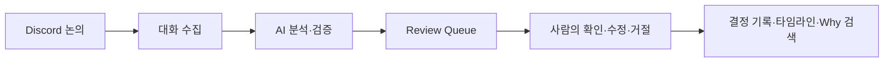
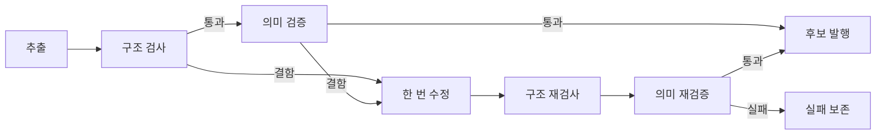
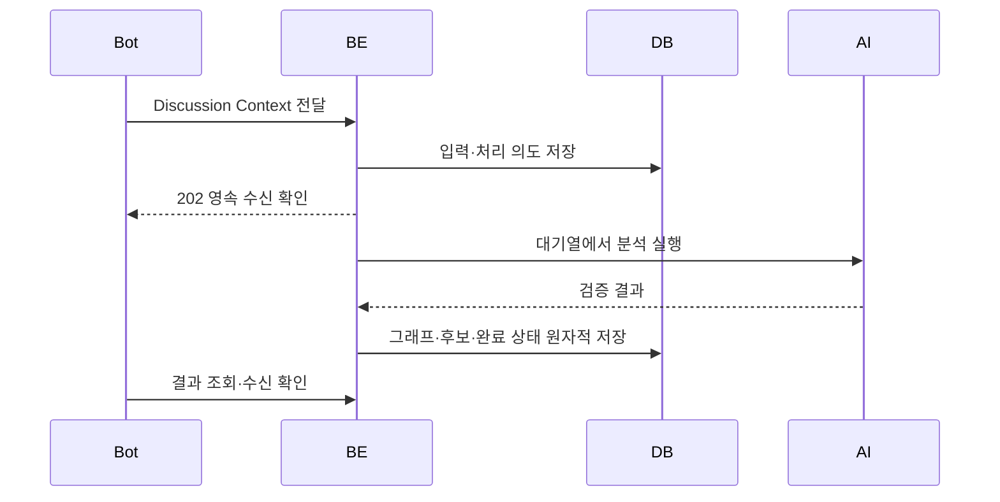
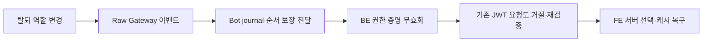

# GGADDAK 개발 진행 발표

중간 리뷰 취합용 BE·Bot **5장·약 3분 자료**는 [BE 중간 리뷰 제출 자료](be-mid-review.md)를 사용합니다. 이 문서는 상세 구조 설명을 위한 부록입니다.

발표 기준: 2026-11-03 · 약 8~10분 · 각 번호를 슬라이드 한 장으로 사용합니다.

## 1. 우리가 풀고 있는 문제

**대화에서 내린 결정과 그 이유를 나중에도 찾을 수 있게 합니다.**

- Discord 대화 속에서 결정, 제안, 반론이 함께 흘러갑니다.
- 결론만 남으면 어떤 대안을 검토했고 왜 선택했는지 다시 설명해야 합니다.
- GGADDAK은 대화의 근거를 연결한 결정 후보를 만들고, 사람이 검수한 기록을 제공합니다.

발표 멘트: “어떤 결정을 했는지와 함께, 왜 그렇게 결정했는지를 팀의 기록으로 남기는 서비스입니다.”

---

## 2. 사용자가 경험하는 흐름

- 일반 대화 추적과 사용자가 요청한 과거 스캔을 지원합니다.
- AI 결과는 Decision Candidate이며, 사람의 검수 전에는 Draft입니다.
- 봇 설치나 서버 초대만으로 과거 대화를 자동 스캔하지 않습니다.

발표 멘트: “AI가 찾아낸 후보를 사람이 확인하는 단계를 두어, 대화 중 제안이 확정된 결정으로 오해되지 않게 했습니다.”

---

## 3. 전체 시스템의 역할 분리

| 구성 | 맡는 일 | 이번까지 정리한 부분 |
| --- | --- | --- |
| Bot | Discord 수집·이벤트 전달·반응 표시 | 전달 실패 복구, 명시적 스캔, 서버 변경 이벤트 |
| BE | 분석·검증·저장·권한 검사·API | 영속 큐, 분석 상태, 원자적 발행, 서버 격리 |
| FE | 검수·조회·검색·설정 | 서버별 화면, 로그인 복구, 권한 상실 시 캐시 정리 |
| Shared | 공통 타입·검증·정책 | Bot과 BE의 계약 및 상태 표현 공유 |

발표 멘트: “Discord 연결을 담당하는 봇과 AI 분석을 담당하는 백엔드를 분리했습니다. 프론트엔드는 공개된 API 계약을 기준으로 연결합니다.”

근거: [Context Map](../CONTEXT-MAP.md), [API 문서 안내](api/README.md).

---

## 4. AI 분석은 단계별 검증을 거칩니다

- 원문에 없는 근거·담당자·마감일, 거짓 합의, 누락된 제안을 검사합니다.
- 근거가 언급되지 않았다면 `not_stated`로 남깁니다.
- 세션당 수정 최대 1회, 논리 호출 최대 4회로 반복을 제한합니다.
- 구조 검사와 AI 의미 검증은 별도 단계입니다. 검증 통과가 사실성의 절대 보장을 뜻하지는 않습니다.

발표 멘트: “결과 생성 뒤에 구조 검사와 원문 대조를 붙였고, 수정도 한 번만 허용합니다. 검증이 실패하면 결과를 억지로 공개하지 않습니다.”

근거: [AI 분석 구조](ai-agentic-architecture.md), [분석 API](api/agentic-analysis.md).

---

## 5. 결정과 이유를 연결해서 저장합니다

| 정보 | 기록하는 내용 |
| --- | --- |
| Topic / Issue | 무엇에 대한 논의인가 |
| Decision Candidate | 어떤 선택이 제안·합의·철회됐는가 |
| Alternative | 함께 검토한 다른 선택은 무엇인가 |
| Rationale | 선택을 지지하거나 반대하는 근거는 무엇인가 |
| Action Item | 이후 해야 할 일은 무엇인가 |

- 분석의 관찰 상태와 사람이 승인한 결정 상태를 구분합니다.
- 원본 그래프와 검수 후 카드의 변경 이력을 구분해 보존합니다.
- 검수·편집은 읽었던 버전을 함께 보내 오래된 화면의 덮어쓰기를 거절합니다.

발표 멘트: “결정 한 문장뿐 아니라 대안과 근거를 연결하므로, 나중에 그 선택의 맥락을 확인할 수 있습니다.”

---

## 6. 전달 성공과 분석 성공을 구분합니다

- 202는 입력을 저장했다는 뜻이며 분석 완료를 의미하지 않습니다.
- 재시작 뒤에도 보존된 입력과 체크포인트로 복구합니다.
- 같은 요청 ID의 중복 전달과 내용 변경을 구분합니다.
- 한 요청의 일부 세션이 실패하면 후보를 부분 공개하지 않습니다.

발표 멘트: “느린 AI 처리 때문에 Discord 전달을 계속 반복하지 않도록 했습니다. 수신을 먼저 확정하고 분석 결과는 따로 확인합니다.”

---

## 7. 웹 검수와 조회 경로를 갖췄습니다

- Review Queue에서 후보를 확인·수정·거절하거나 기존 결정을 대체합니다.
- Decision Timeline, 목록·상세·이력, Dashboard와 Why 검색 API를 제공합니다.
- 선택한 서버의 봇 설치 상태와 관리자용 설치 링크를 제공합니다.
- 설치 상태는 `installed / not_installed / unknown`으로 구분합니다.
- TSOA에서 Swagger를 만들고 Orval로 데모 FE의 타입과 클라이언트를 생성합니다.

발표 멘트: “API 제공과 데모 화면의 검증까지 진행했습니다. 별도로 개발하는 실제 FE의 연결 완료 여부는 별도 체크리스트로 관리합니다.”

근거: [FE 연동 계약](api/frontend-api.md), [봇 설치 안내](api/bot-installation.md).

---

## 8. 최근 보완: 가입한 서버에만 접근

**로그인했다고 봇이 참여한 모든 서버를 볼 수 있는 것은 아닙니다.**

- 서버 목록은 로그인한 사용자의 가입 정보를 기준으로 만듭니다.
- `guildId`나 결정 ID를 바꿔 다른 서버를 요청해도 BE에서 거절합니다.
- 채널 설정 등 관리 작업은 추가 권한을 확인합니다.
- 기존 전역 피드백 API는 Bot 서비스 인증만 허용하도록 차단했습니다.
- 봇이 제거된 것과 사용자가 탈퇴한 것은 다릅니다. 봇이 없어도 가입 사용자는 기존 결정 기록을 조회할 수 있습니다.

발표 멘트: “서버 선택 UI에만 의존하지 않고, 모든 데이터 요청의 서버 접근 범위를 백엔드에서 확인합니다.”

---

## 9. 최근 보완: 변경 이벤트로 권한 갱신

| 상황 | 동작 |
| --- | --- |
| 변경 없이 화면을 열어둠 | 10분·15분 주기의 Discord 권한 조회 없음 |
| JWT만 만료 | 브라우저 쿠키로 JWT 재발급, Discord 조회 없음 |
| 사용자 탈퇴·역할 변경 | 관련 권한을 무효화 |
| 봇 미설치·멤버 intent 미설정·연결 공백 | 실제 데이터 접근 시 OAuth 재검증 |

연결 확인용 heartbeat는 로컬 Bot→BE 통신이며 Discord 권한 조회를 하지 않습니다. Bot이 갑자기 종료되면 최대 35초의 연결 lease 만료로 감지합니다.

발표 멘트: “정기적으로 전체 권한을 다시 읽는 대신 변경을 반영합니다. 이벤트를 관측할 수 없는 경우에는 실제 접근 시 다시 확인합니다.”

근거: [권한 운영](operations/guild-access.md).

---

## 10. 리뷰에서 실제 SDK의 누락 경로도 보완했습니다

| 발견한 문제 | 보완 |
| --- | --- |
| SDK 캐시에 없는 멤버의 탈퇴 이벤트 누락 | raw Gateway Dispatch에서 수신 |
| 재접속 Resume 중 상위 멤버 이벤트 생략 | 재생된 raw 이벤트도 순서대로 반영 |
| unavailable 서버 복구 이벤트가 새 서버 초대와 다름 | raw `GUILD_CREATE`로 관측 상태 복구 |
| 새 권한 서비스가 DB에 직접 접근 | Repository로 저장 책임 분리 |

발표 멘트: “이벤트 이름을 직접 발생시키는 테스트에 더해, 설치된 Discord SDK의 실제 패킷 처리 경로로 누락을 재현하고 수정했습니다.”

---

## 11. 검증 결과와 확인 범위

2026-11-03 최종 전체 실행 기록:

| 검증 | 결과 |
| --- | --- |
| BE | 175개 통과 |
| Bot | 53개 통과 |
| FE | 21개 통과, 실제 Chrome 흐름 포함 |
| E2E | 9개 통과, 실제 Bot publisher→BE HTTP 포함 |
| 타입 검사 / lint | 타입 검사 통과, lint 오류 0·기존 경고 1 |
| 재리뷰 | Standards 0건 / Spec 0건 |

Shared 테스트도 전체 workspace 실행에 포함돼 통과했습니다. 이 수치는 해당 실행의 회귀 결과이며, 실제 Discord 운영 계정이나 AI 추출 정확도·성능 측정 결과를 뜻하지 않습니다.

근거: [검증 기록](../.scratch/guild-access-hardening/verification.md).

---

## 12. 시연 순서와 남은 적용 항목

시연용 가상 논의: “SQLite와 PostgreSQL 중 무엇을 쓸까? 이번 범위는 SQLite로 진행하자.” 실제 정확도 측정 사례가 아닙니다.

1. Discord 로그인 → 본인 서버 선택.
2. 봇 설치 상태와 감시 채널 확인.
3. 가상 논의를 분석해 Review Queue의 후보·근거 확인.
4. 사람이 승인 → 결정 목록과 타임라인에서 확인.
5. 다른 서버 ID 접근 거절과 권한 상실 후 화면 복구 확인.

배포 전에는 선택 DB 백업·신규 migration 적용, Discord Server Members Intent 활성화와 Bot 환경 설정이 필요합니다. 실제 Discord 탈퇴·재가입·재설치와 별도 FE 연동은 운영 환경에서 확인해야 합니다. 서버별 웹 External Feedback 기능은 후속 범위입니다.

마지막 멘트: “대화를 결정 기록으로 바꾸는 흐름에, 검수·장애 복구·서버 권한 검증까지 연결했습니다. 다음 단계는 실제 사용 환경에서 연결과 운영 동작을 확인하는 것입니다.”
